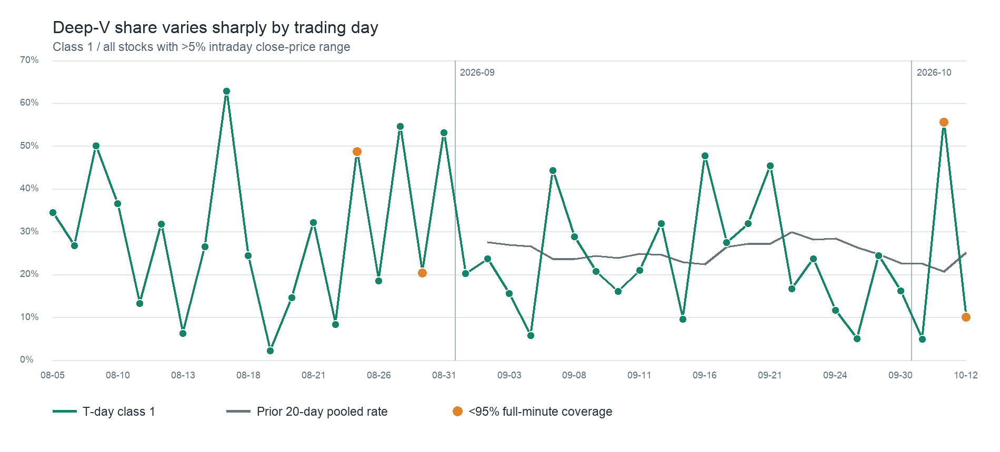

# 深 V 样本逐日分布

口径、数据质量条件见 [D1 主报告](README.md)。`1/0/-1` 的百分比均以当日振幅超过 5% 的完整分钟股票日为分母；前 20 日列是 T−20…T−1 合计比例，不包含 T 日。8 月 3、4 日无完整分钟数据，所以表中从 8 月 5 日开始，前 20 日列从 9 月 2 日开始。

## 2026-08

| 日期 | 完整分钟／有分钟股票 | 振幅>5% | 1：收盘≥高点−1% | 0：−3%～−1% | −1：低于−3% | 前20日1类占比 |
|---|---:|---:|---:|---:|---:|---:|
| 2026-08-05 | 5,528/5,528 | 1,113 | 383 (34.4%) | 589 (52.9%) | 141 (12.7%) | — |
| 2026-08-06 | 5,529/5,529 | 964 | 257 (26.7%) | 410 (42.5%) | 297 (30.8%) | — |
| 2026-08-07 | 5,529/5,529 | 1,134 | 568 (50.1%) | 399 (35.2%) | 167 (14.7%) | — |
| 2026-08-10 | 5,532/5,532 | 988 | 361 (36.5%) | 273 (27.6%) | 354 (35.8%) | — |
| 2026-08-11 | 5,533/5,533 | 829 | 109 (13.1%) | 340 (41.0%) | 380 (45.8%) | — |
| 2026-08-12 | 5,532/5,532 | 615 | 195 (31.7%) | 244 (39.7%) | 176 (28.6%) | — |
| 2026-08-13 | 5,533/5,533 | 1,047 | 65 (6.2%) | 159 (15.2%) | 823 (78.6%) | — |
| 2026-08-14 | 5,531/5,531 | 696 | 184 (26.4%) | 174 (25.0%) | 338 (48.6%) | — |
| 2026-08-17 | 5,530/5,530 | 870 | 546 (62.8%) | 212 (24.4%) | 112 (12.9%) | — |
| 2026-08-18 | 5,524/5,524 | 775 | 189 (24.4%) | 221 (28.5%) | 365 (47.1%) | — |
| 2026-08-19 | 5,525/5,525 | 2,038 | 44 (2.2%) | 53 (2.6%) | 1,941 (95.2%) | — |
| 2026-08-20 | 5,524/5,524 | 883 | 129 (14.6%) | 282 (31.9%) | 472 (53.5%) | — |
| 2026-08-21 | 5,525/5,525 | 829 | 266 (32.1%) | 310 (37.4%) | 253 (30.5%) | — |
| 2026-08-24 | 5,530/5,545 | 1,352 | 112 (8.3%) | 221 (16.3%) | 1,019 (75.4%) | — |
| 2026-08-25 | 3,653/5,105 | 848 | 413 (48.7%) | 309 (36.4%) | 126 (14.9%) | — |
| 2026-08-26 | 5,106/5,106 | 597 | 110 (18.4%) | 211 (35.3%) | 276 (46.2%) | — |
| 2026-08-27 | 5,106/5,106 | 747 | 408 (54.6%) | 230 (30.8%) | 109 (14.6%) | — |
| 2026-08-28 | 4,635/5,105 | 532 | 108 (20.3%) | 147 (27.6%) | 277 (52.1%) | — |
| 2026-08-31 | 5,103/5,103 | 943 | 501 (53.1%) | 240 (25.5%) | 202 (21.4%) | — |

## 2026-09

| 日期 | 完整分钟／有分钟股票 | 振幅>5% | 1：收盘≥高点−1% | 0：−3%～−1% | −1：低于−3% | 前20日1类占比 |
|---|---:|---:|---:|---:|---:|---:|
| 2026-09-01 | 5,099/5,102 | 590 | 119 (20.2%) | 158 (26.8%) | 313 (53.1%) | — |
| 2026-09-02 | 5,102/5,102 | 570 | 135 (23.7%) | 191 (33.5%) | 244 (42.8%) | 27.6% |
| 2026-09-03 | 5,087/5,103 | 607 | 94 (15.5%) | 189 (31.1%) | 324 (53.4%) | 27.0% |
| 2026-09-04 | 5,101/5,101 | 1,196 | 69 (5.8%) | 133 (11.1%) | 994 (83.1%) | 26.6% |
| 2026-09-07 | 5,100/5,100 | 572 | 253 (44.2%) | 204 (35.7%) | 115 (20.1%) | 23.7% |
| 2026-09-08 | 5,082/5,100 | 562 | 162 (28.8%) | 159 (28.3%) | 241 (42.9%) | 23.6% |
| 2026-09-09 | 5,095/5,099 | 523 | 108 (20.7%) | 122 (23.3%) | 293 (56.0%) | 24.3% |
| 2026-09-10 | 5,097/5,097 | 456 | 73 (16.0%) | 127 (27.9%) | 256 (56.1%) | 23.9% |
| 2026-09-11 | 5,097/5,097 | 945 | 198 (21.0%) | 315 (33.3%) | 432 (45.7%) | 24.9% |
| 2026-09-14 | 5,219/5,219 | 879 | 280 (31.9%) | 365 (41.5%) | 234 (26.6%) | 24.6% |
| 2026-09-15 | 5,217/5,217 | 591 | 56 (9.5%) | 130 (22.0%) | 405 (68.5%) | 22.9% |
| 2026-09-16 | 5,204/5,222 | 825 | 394 (47.8%) | 335 (40.6%) | 96 (11.6%) | 22.4% |
| 2026-09-17 | 5,098/5,098 | 503 | 138 (27.4%) | 171 (34.0%) | 194 (38.6%) | 26.5% |
| 2026-09-18 | 5,098/5,098 | 602 | 192 (31.9%) | 245 (40.7%) | 165 (27.4%) | 27.3% |
| 2026-09-21 | 5,098/5,098 | 710 | 322 (45.4%) | 245 (34.5%) | 143 (20.1%) | 27.2% |
| 2026-09-22 | 5,097/5,097 | 563 | 94 (16.7%) | 185 (32.9%) | 284 (50.4%) | 30.0% |
| 2026-09-23 | 5,098/5,098 | 550 | 130 (23.6%) | 176 (32.0%) | 244 (44.4%) | 28.2% |
| 2026-09-24 | 5,098/5,098 | 535 | 62 (11.6%) | 87 (16.3%) | 386 (72.1%) | 28.5% |
| 2026-09-28 | 5,097/5,098 | 1,214 | 60 (4.9%) | 101 (8.3%) | 1,053 (86.7%) | 26.3% |
| 2026-09-29 | 5,098/5,098 | 504 | 123 (24.4%) | 214 (42.5%) | 167 (33.1%) | 24.7% |
| 2026-09-30 | 5,098/5,098 | 667 | 108 (16.2%) | 156 (23.4%) | 403 (60.4%) | 22.7% |

## 2026-10

| 日期 | 完整分钟／有分钟股票 | 振幅>5% | 1：收盘≥高点−1% | 0：−3%～−1% | −1：低于−3% | 前20日1类占比 |
|---|---:|---:|---:|---:|---:|---:|
| 2026-10-08 | 5,094/5,094 | 1,386 | 68 (4.9%) | 93 (6.7%) | 1,225 (88.4%) | 22.5% |
| 2026-10-09 | 4,626/5,095 | 1,905 | 1,059 (55.6%) | 588 (30.9%) | 258 (13.5%) | 20.7% |
| 2026-10-12 | 3,646/5,097 | 548 | 55 (10.0%) | 90 (16.4%) | 403 (73.5%) | 25.2% |

原始派生数据：[逐日明细](../../../outputs/stock_automl/deep_v_20261013/daily_rates.csv)、[T 日与前 20 日对照](../../../outputs/stock_automl/deep_v_20261013/daily_vs_history20.csv)。8 月 25、28 日及 10 月 9、12 日分钟覆盖不足 95%，图中以橙点标记；其余日期仍可能有少量股票缺完整分钟数据。
