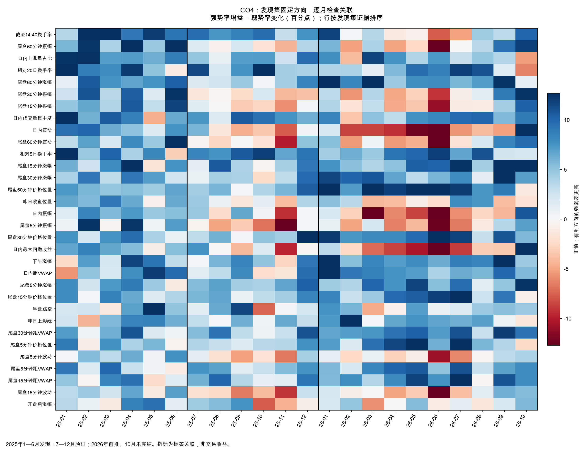

# CO4：76 个简单因子的时间验证

## 主要结果

**找到了值得继续验证的简单关联，但尚未得到新的交易模型。** 76 项中 39 项通过发现筛选，发现期去冗余得到 32 个代表；16 项同时通过 2025 下半年验证与 2026 前推的预设支持条件，其中 12 项为发现期选定的代表。前推单独通过 25 项，未通过 2025 下半年的另外 9 项不计为跨期通过。16 项包含多个相近窗口，不能视为 16 条独立规律。

较一致的方向是：在 14:40 已上涨 3%—6% 的同日候选里，**相对近期成交没有那么亢奋、临近决策时没有继续追涨、价格处于近段区间相对较低位置**的股票，次晨强弱标签结构较好。它允许“涨得不错，但近期略有回吐”的形态；不是寻找绝对弱势股，也不是认为越低越安全。

下表方向均为**较低**。差值是有利尾组减相反尾组，每天等权，单位为百分点。

| 因子 | 2025下半年强弱差 | 同向月份 | 2026强势率差 | 2026弱势率差 | 2026强弱差 | 同向月份 |
|---|---:|---:|---:|---:|---:|---:|
| 相对前5日换手率 | +9.01 | 6/6 | +3.95 | -3.29 | +7.24 | 10/10 |
| 末5分钟涨幅 | +6.36 | 6/6 | +2.06 | -4.69 | +6.75 | 10/10 |
| 末15分钟涨幅 | +4.94 | 5/6 | +2.24 | -6.10 | +8.34 | 10/10 |
| 末30分钟价格位置 | +5.37 | 6/6 | +3.45 | -6.08 | +9.53 | 10/10 |
| 末60分钟价格位置 | +5.13 | 6/6 | +4.54 | -6.78 | +11.32 | 9/10 |
| 日内成交量集中度 | +7.10 | 6/6 | +1.85 | -4.69 | +6.54 | 9/10 |
| 相对前20日换手率 | +6.93 | 6/6 | +1.12 | -5.04 | +6.16 | 9/10 |

2026 年 10 月仅有 **4 个信号日**，不能把 10/10 同向当作十个完整月份的证据；上表中 10/10 的因子也分别在此前 9 个完整月份同向。相对 5 日换手率的 2026 强弱差 95% 五日块区间为 **[4.40, 10.13] 个百分点**，末 30 分钟价格位置为 **[7.39, 11.58]**。不过它们区分“强势与全部其他候选”的日均 AUC 分别仅约 **0.525、0.530**；信号较弱，远不等于能准确挑中单只股票。

### 剔除最好月份与滚动方向

“去最好月”是剩余月份等权均值，不是先合并交易后计算收益。滚动列表示每月仅用此前 60 个标签已成熟的交易日估计方向，10 个窗口都完整；这里滚动的是单因子方向，没有拟合或评估组合模型。

| 因子 | 2026月均强弱差 | 最差月 | 去最好月 | 60日方向与发现一致 |
|---|---:|---:|---:|---:|
| 相对前5日换手率 | +6.84 | +2.17 | +6.28 | 10/10 |
| 末5分钟涨幅 | +7.13 | +1.45 | +6.54 | 10/10 |
| 末15分钟涨幅 | +8.75 | +3.81 | +8.11 | 10/10 |
| 末30分钟价格位置 | +9.17 | +2.89 | +8.54 | 10/10 |
| 末60分钟价格位置 | +10.22 | -1.23 | +9.68 | 10/10 |
| 日内成交量集中度 | +6.40 | -3.47 | +5.99 | 10/10 |
| 相对前20日换手率 | +5.09 | -6.28 | +4.34 | 10/10 |

### 逐月明细

下表展示四项不同含义的因素，均按发现期的“较低”方向固定比较。完整 76 项、三种集合的逐月记录见 [factor_monthly.csv](factor_monthly.csv)；可读总表见 [中文因子总表](factor_overview_zh.csv)。

| 信号月 | 相对5日换手率 | 末5分钟涨幅 | 末30分钟价格位置 | 成交量集中度 |
|---|---:|---:|---:|---:|
| 2025-07 | +8.43 | +5.50 | +3.19 | +7.36 |
| 2025-08 | +7.61 | +6.75 | +6.04 | +1.75 |
| 2025-09 | +10.67 | +4.37 | +0.35 | +10.55 |
| 2025-10 | +11.81 | +4.16 | +4.99 | +9.48 |
| 2025-11 | +6.64 | +6.74 | +4.42 | +7.56 |
| 2025-12 | +9.28 | +10.24 | +13.17 | +6.24 |
| 2026-01 | +4.32 | +4.46 | +12.15 | +8.51 |
| 2026-02 | +6.17 | +3.84 | +7.41 | -3.47 |
| 2026-03 | +4.68 | +10.08 | +8.06 | +5.20 |
| 2026-04 | +9.23 | +7.52 | +8.09 | +3.21 |
| 2026-05 | +9.94 | +11.65 | +9.90 | +7.70 |
| 2026-06 | +11.86 | +5.36 | +14.85 | +8.25 |
| 2026-07 | +6.65 | +9.65 | +11.74 | +9.92 |
| 2026-08 | +11.04 | +1.45 | +2.89 | +10.10 |
| 2026-09 | +2.33 | +4.87 | +10.82 | +5.60 |
| 2026-10（4日） | +2.17 | +12.43 | +5.74 | +9.00 |



### 哪些想法没有通过

- **低换手不等于有效找强势。** 截至 14:40 的绝对换手率较低，在验证期令强势率减少 6.57、弱势率减少 14.24 个百分点；2026 分别减少 8.76、9.90 个百分点。它主要压低两端，未通过双目标条件。相对近期自身的换手率与绝对换手率应分开理解。
- **低波动没有跨期一致。** 末 5 分钟振幅的发现强弱差为 +5.45，验证变为 −4.53，2026 为 −2.96；末 15 分钟波动分别为 +3.83、−3.40、−1.87 个百分点。滚动改方向也未形成每月一致优势。
- **市值代理没有得到跨期支持。** 本轮流通市值代理未通过发现筛选，2026 强弱差只有 +0.65 个百分点。不能据此断言市值无用，它可能只在条件交互或风险控制中有用。
- **分层并非完全相同。** 相对 5 日换手率、末 5 分钟涨幅和末 30 分钟位置在非 ST、主板、创业板／科创板分层仍总体同向；但末 15 分钟涨幅在主板验证期强势率反而下降 0.84 个百分点、仅 2/6 月强弱差同向。详细分层是敏感性观察，未重新筛因子或修改支持名单。

### 下一步如何使用

优先把相对成交、末段回吐和区间位置作为少数可解释变量，先比较有正则约束的简单概率模型：分别预测强势与弱势概率，再观察能否同时提高上行概率、控制下行概率。不要强行把相关性很高的多个窗口全部塞入模型，也不要把低风险因素误当成高收益因素。

后续若比较 CNN，应在同一候选、同一决策时刻和同一滚动月份上，比较“全局变量”“分钟序列”“二者结合”，并继续保留逐月表现、删最好月、扰动训练样本和多个种子的检查。模型选择需在训练内部完成；本轮看到的月份已成为研究证据，新的最终确认需要真正后续月份。本轮按用户要求停在因子调查，未开始这一步训练。

## 本轮问题与边界

只研究收盘—开盘策略。目标是先寻找可跨月重复的变量关联，再决定怎样训练模型。本轮没有训练组合预测模型，也没有修改 B1 的七因子、scikit-learn 1.7.1 环境或冻结名单。

原 CO3 CNN 是 **14:30、14:35、14:40、14:45、14:50、14:55 六切面 × 10 个加工特征**，并非只用成交量或全天原始 OHLC。它按月使用此前 20 日训练，三个种子仅 130/288 日 Top1 相同，没有形成可跨期确认的增益；见 [CO3](../20261014_close_open_screen_sequence_targets/README.md)。

本轮保持 14:40 决策，使用原七因子概念、历史量价背景、09:31—14:40 的 220 根分钟路径，以及末 5／15／30／60 分钟特征，共 76 项。全路径中的“全天”只到决策时刻；不使用收盘后才知道的数据。具体公式见 [因子字典](factor_dictionary.csv)，事先固定的方法见 [DESIGN](DESIGN.md)。

强势标签：次晨 09:31—09:40 第二大分钟最高价，相对当天 14:40 价达到 +3%。弱势标签：该十分钟的最高价仍低于当天 14:40 价。其余保留为中间组。这里研究的是隔夜早盘表现，并非严格意义的开盘跳空。

## 数据来源与复用

- 本机 `mk_1m_compact_2025`：2025 年全部 243 个交易日；本机 `mk_1m_compact`：2026 年 1—7 月 139 日。
- kingdomai 的最终态、精确分钟时间记录：2026-08-03—10-14 共 47 日。最终信号截至 10 月 13 日，10 月 14 日早盘用于标签；10 月尚未完结。
- 用户提供的 `mk202512.tar.xz.part` 下载完成为 `mk202512.tar.xz` 后，恢复 23 个未复权逐日文件；原包 SHA-256 和全部逐日原文哈希均与旧归档记录吻合。原压缩包保留；详见 [12 月恢复记录](december_restore.json)。
- 原始分钟、日线和历史 ST 使用已有快照，新增 76 项因子重新计算；完成后的逐日特征作为本轮统计缓存。中断续跑只重用已完成的同定义日缓存。更改因子定义必须另建实验和数据目录。
- 日线使用已有月缓存，前收与滞后量价用于构造当时可见特征；当日最终 OHLC 不进入预测因子。连续历史价格通过 close/preclose 链计算，避免未来复权因子进入历史特征。流通市值与股本为滞后量／换手代理，不声称逐行等同 B1。
- 本地量以股计；数据库分钟量从手换为股，金额均为元。抽核 2026-08-03、08-06 分钟成交均价／收盘价中位数约为 1，未见百倍单位错位。来源切换、历史补录和最终态档案仍不能证明当年实时可获得同样输入。

在已观察到 14:40 价格且具备历史的 160,409 条涨幅带候选中，完整路径与基础输入合格的有 160,252 条；再排除 4,441 条当时涨停的 ST，得到 **155,811 条、428 个信号日**。其中 137 条次晨标签未知，另有 682 条因集合边界标签尚未成熟而从关联分析中移除。未知项不填零、不当负例。

| 集合 | 信号范围 | 行数 | 信号日数 | 强势标签比例 | 弱势标签比例 |
|---|---|---:|---:|---:|---:|
| 发现 | 2025-01-02—06-27 | 41,696 | 116 | 13.15% | 17.50% |
| 验证 | 2025-07-01—12-30 | 37,283 | 125 | 13.16% | 21.13% |
| 前推 | 2026-01-05—10-13 | 76,013 | 185 | 14.22% | 19.89% |

上表标签比例按样本数计，仅用于描述；因子主指标按日等权。429 日“有来源”不代表所有股票完整，14:40 本身缺失的股票甚至不能进入上述分母。例如 10 月 13 日数据库 14:40 记录只有 4,627 只，低于近期约 5,225 只；本轮可观察候选的 283 条路径完整，但不能据此宣称当天全市场完整。10 月 14 日仅参与次晨标签，没有作为决策样本。见 [逐日覆盖](minute_coverage.csv)、[逐月样本](sample_coverage_monthly.csv) 和 [完整性核查](panel_integrity.json)。

**量额一致性补查：** 少量小成交分钟存在量额不匹配，不能用单分钟量额商直接替代真实价格。扩大到本轮窗口后，截至 14:40 的全路径 VWAP 均位于区间内；末 5 分钟 155,806 条可计算记录中，567 条超出区间超过一分钱，其中 53 条超出幅度超过股价的 0.5%（约 0.034%）；末 15／30 分钟分别仅 11／2 条超过 0.5%，末 60 分钟为零。总体比例很小，短窗口 VWAP 仍附此数据质量限制；没有事后删除这些样本重新筛选。见 [逐月量额诊断](vwap_source_quality_monthly.csv)。

去次日除权等价格基准变化的分层是事后诊断，不可作为信号日交易筛选；缺次日基准信息的记录也不进入该分层。

## 如何解释统计值

每个交易日只在当时涨幅 3%—6% 的沪深候选中排名，比较因子有利方向的 20% 与相反方向的 20%。并列值不强行拆分，二元变量直接比较 1 与 0，每组至少 5 只；每天等权。主指标为 **强势率差 − 弱势率差**，单位为百分点，正值表示标签结构更有利，不能读成每笔收益率。

方向、数值分箱和候选因子只用 2025 年 1—6 月确定；2025 年 7—12 月验证；2026 年前推。边界日标签跨入下一集合的样本从前一集合移除。发现阶段做 76 项多重检验修正，后两段各只对发现候选修正。支持条件同时要求区间、修正显著性、至少三分之二月份同向，并且强势率不下降、弱势率不上升。所有通过和失败的因子均披露。

有利方向是**条件关联**：例如在已经上涨 3%—6% 的股票中，相对成交不那么亢奋可能更好，不能外推为“所有股票越缩量越好”。分层只缓解部分混杂；市场、行业、流动性和候选筛选仍可能影响关系。相近窗口的同族因子也不能当多条独立证据。

这些历史时期已被旧策略研究过，是本轮的时间留出，不能称整个项目从未见过的盲测。五日块重抽样及 FDR 是探索性不确定性控制，不是因果或未来收益保证。

## 复现与证据

代码冻结：设计与主体实现 `5e4b2bd`；精度保留、覆盖统计与展示 `10c11a4`。发现集方向先冻结再打开验证集；最终规则还与先前冻结的 2025 阶段规则核对。

```bash
.venv-automl/bin/python -m scripts.build_automl_close_open_factor_panel --audit-availability
.venv-automl/bin/python -m scripts.build_automl_close_open_factor_panel --workers 3
.venv-automl/bin/python -m scripts.analyze_automl_close_open_factors
.venv-automl/bin/python -m scripts.summarize_automl_close_open_factors
```

已有本轮逐日缓存时，用 `--assemble-only` 仅合并，不重复解析全市场分钟。因子宽表及逐日关联保存在 `outputs/stock_automl/close_open_factor_discovery_r1/`；报告清单绑定源数据、面板、冻结规则、脚本及依赖版本哈希。

针对本轮及已有收盘—开盘目标／序列口径的测试共 **18 项通过**，包括未来日线和 14:40 后数据隔离、缺分钟、第二高价并列、未知标签、集合边界、排名并列和方向冻结。此处只报告专项测试，不代表整个仓库全量测试通过。


## 归档与提交

代码、完整统计结果及月度图已推送至 `origin/codex/stock-automl-strategies`，研究内容提交 `b534fb9`。完整样本、逐日缓存、数据库候选分钟、历史日线、冻结规则及报告整理为 **416,909,259 字节**的 ZIP；内含 1,399 个被清单覆盖的文件及 SHA256SUMS，全部从包内回读哈希通过。数据库研究归档记录已回读，`local_check=ok`。

本地镜像：`outputs/stock_automl/aliyun_drive_local/策略训练/收盘开盘_20261014/03_因子筛选_7至14/20261014_CO4_76因子_时间验证`。便于上传的 ZIP 位于 `outputs/stock_automl/close_open_factor_discovery_r1/CO4_76因子_时间验证_20261014.zip`，SHA-256 为 `751ae7b1ae0dc5e9e2b80b9c5daf581b815edaf896082588005ae830812e747e`。

2026-10-14 用户曾选择“先保留本地包，稍后上传”；2026-10-15 用户指出阿里云盘桌面客户端已打开，已恢复归档。完整云端回读结果与 `cloud_verified_at` 见[归档回执](archive_receipt.json)。本地研究包和校验清单保持原样。
