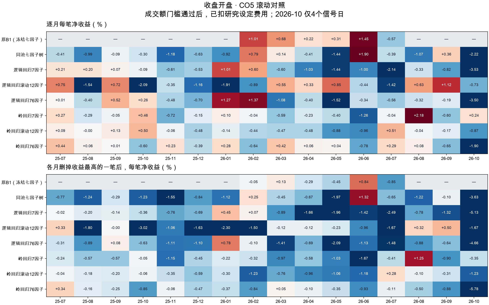

# CO5：简单模型滚动训练，与原 1.7.1 七因子对照

更新：2026-10-14。**本轮没有找到稳定盈利、可以替换 B1 的新方案。** 扩展因子确实降低了部分风险或改善部分命中，但这两者尚未同时转化为跨月净盈利。保留原 B1 资产，本轮结果作为后续研究证据。

## 先解释因子结论

CO4 的 16 个“通过因子”是严格双阶段验证后的强证据组，不能解释为其余 60 个无用。弱单变量关联、条件关联和业务合理性是不同问题。本轮做了：七因子控制、每月重选 12 因子、全部 76 因子。市值、绝对/相对换手、三个 0/1 因子、历史走势、全日和尾盘路径都在 76 因子模型中；未因单变量不显著删除。

CO4 最终名单利用了 2026 年表现，直接用它回测 2025–26 年会混入选择信息。因此本轮紧凑组只根据每轮训练段的日内强弱差重新选 12 个，接受正、负两个方向，也不设显著性硬门槛。共有多少月选中哪些变量见 [逐月因子](factor_selection_by_month.csv) 与 [选择频次](compact_factor_frequency.csv)。它不是同一个固定 12 因子组合。

## 实际执行

- 数据：CO4 冻结的 155,811 行、76 个因子；信号 14:40，收益为次晨 09:40 收盘价。测试 2025-07 至 2026-10-13，共 311 日、16 个月；10月仅4日，不与完整月份等量解释。
- 每个月：此前100个市场交易日，前80日训练与选因子、后20日选正则参数；再用这100日重拟合，整月固定。发现、验证和测试信号日互不重叠，边界前一日标签若已于当天09:40成熟可使用。缩放、截尾、填补均只在对应拟合段学习。
- 逻辑回归：弱/中/强三类，按 P(强)−P(弱) 排序。岭回归：预测封顶盈利、加重超过2%亏损惩罚后的净收益效用。6个方案均公布，不根据测试结果只保留赢家。
- 原B1保留真实冻结输出：2026-02-02至07-30的118日，115日有Top1、3日轮空。门槛通过91笔、未通过20笔，另4笔因历史成交额不足20日无法核定，保留未知。
- 同池七因子树采用原1.7.1参数、前20日每日滚动。CO4股本/均线构造与原输入不完全相同，**同配置控制不是B1复现**。简单模型的100日/月度更新与树的20日/每日更新也不同，不能把差异全部归因于模型类型。
- 每个模型先选第一名，再应用原个股成交额门槛，不递补。完整结果同时保留不使用门槛的版本。

## 共同日期对照：原B1可核实的2026年2–7月

以下强势命中率与亏损率均以门槛通过、结果已知的交易为分母。强势为次晨十分钟次高价 ≥ 买价×1.03；“净亏≥2%”为实际09:40净亏损，二者并非互补。

| 模型 | 笔数 | 每笔净收益% | 强势命中% | 弱势命中% | 净亏≥2%占比 | 每月删最好一笔后% | 门槛未知数 |
| --- | --- | --- | --- | --- | --- | --- | --- |
| 原B1（冻结七因子） | 91 | 0.470 | 30.769 | 18.681 | 20.879 | -0.120 | 4 |
| 同池七因子树 | 93 | 0.101 | 26.882 | 19.355 | 21.505 | -0.349 | 3 |
| 逻辑回归7因子 | 102 | -1.053 | 20.588 | 27.451 | 34.314 | -1.513 | 3 |
| 逻辑回归滚动12因子 | 97 | -0.059 | 29.897 | 23.711 | 36.082 | -0.647 | 7 |
| 逻辑回归76因子 | 96 | -0.506 | 23.958 | 26.042 | 37.500 | -1.172 | 4 |
| 岭回归7因子 | 54 | -0.387 | 12.963 | 20.370 | 12.963 | -0.779 | 6 |
| 岭回归滚动12因子 | 75 | -0.374 | 6.667 | 26.667 | 18.667 | -0.653 | 2 |
| 岭回归76因子 | 83 | -0.099 | 8.434 | 16.867 | 13.253 | -0.368 | 2 |

原B1本段仍优于新模型。但每月删掉最好一笔后，B1由 +0.470%/笔变为 −0.120%/笔；再去掉最佳月份为 −0.359%/笔。仅去掉最佳月份（6月）还剩 +0.229%/笔。结论是**收益依赖月内少数大盈利单，不能只凭原总收益判断稳定性**。这项删单检验是刻意苛刻的集中度压力测试，不能单独证明策略来自运气。

[共同日期配对区间](paired_B1.csv)以同一天的净收益差、5交易日区块自助法计算；门槛或收益未知时两侧共同剔除。多数组合的95%区间跨零，不能声称新模型统计上稳定胜出；区间未对多次研究/多模型比较作校正。

## 较长区间：2025年7月—2026年10月13日

此表只含同一311日上的新样本方案。原B1缺这一完整区间的同口径原始冻结对照，不用新重训结果冒充。

| 模型 | 笔数 | 正收益月份 | 每笔净收益% | 强势命中% | 净亏≥2%占比 | 净亏≥5%占比 | 最差一笔% | 最差5%均值% |
| --- | --- | --- | --- | --- | --- | --- | --- | --- |
| 逻辑回归76因子 | 270 | 5/16 | -0.248 | 26.296 | 31.852 | 7.407 | -16.354 | -8.176 |
| 逻辑回归滚动12因子 | 265 | 7/16 | -0.336 | 28.302 | 35.094 | 9.057 | -12.041 | -8.538 |
| 逻辑回归7因子 | 262 | 5/16 | -0.508 | 20.992 | 27.863 | 6.870 | -20.114 | -8.285 |
| 岭回归76因子 | 230 | 10/16 | -0.073 | 6.087 | 8.261 | 0.870 | -6.271 | -3.260 |
| 岭回归滚动12因子 | 232 | 4/16 | -0.163 | 6.034 | 8.190 | 0.000 | -3.299 | -2.770 |
| 岭回归7因子 | 166 | 5/16 | -0.105 | 10.843 | 10.241 | 0.602 | -5.031 | -3.368 |
| 同池七因子树 | 244 | 4/16 | -0.367 | 20.902 | 25.820 | 6.557 | -16.354 | -7.247 |

76因子岭回归10/16个月为正，但总体 −0.073%/笔；只看15个完整月份仍为 −0.057%/笔（10/15个月为正），并非仅受10月影响。它的强势命中仅6.09%，大量盈利单太小，无法覆盖较少但较大的亏损。逻辑回归提高强势命中时，下跌尾部代价仍高。

## 逐月每笔净收益（%）

均应用成交额门槛、扣除费用，按信号日归属月份。—表示缺少该模型的原始对照，不是0。逐月笔数、收益合计、强弱命中、2%/5%亏损、最差单笔、删单后的数值见 [中文月度明细](月度对照.csv)。

| 月份 | 原B1（冻结七因子） | 同池七因子树 | 岭回归76因子 | 岭回归7因子 | 岭回归滚动12因子 | 逻辑回归76因子 | 逻辑回归7因子 | 逻辑回归滚动12因子 |
| --- | --- | --- | --- | --- | --- | --- | --- | --- |
| 2025-07 | — | -0.414 | 0.439 | 0.274 | 0.088 | 0.013 | 0.209 | 0.753 |
| 2025-08 | — | -0.994 | 0.064 | -0.285 | -0.005 | -0.402 | 0.201 | -1.542 |
| 2025-09 | — | -0.086 | 0.008 | -0.049 | 0.125 | 0.520 | 0.065 | 0.721 |
| 2025-10 | — | -0.295 | -0.598 | 0.456 | 0.495 | 0.262 | -0.086 | -2.089 |
| 2025-11 | — | -1.185 | 0.228 | -0.719 | -0.058 | -0.480 | -0.607 | -0.355 |
| 2025-12 | — | -0.629 | -0.394 | -0.153 | -0.483 | -0.696 | -0.527 | -1.162 |
| 2026-01 | — | -0.917 | 0.276 | 0.103 | -0.136 | 1.267 | 1.006 | -1.907 |
| 2026-02 | 1.012 | 0.790 | -0.637 | -0.037 | -0.439 | 1.373 | 0.598 | -0.894 |
| 2026-03 | 0.676 | 0.136 | 0.416 | -0.590 | -0.474 | -1.084 | -0.600 | 0.545 |
| 2026-04 | 0.224 | -0.413 | 0.060 | -0.230 | -0.478 | -0.397 | -1.030 | 0.327 |
| 2026-05 | 0.313 | -1.439 | 0.044 | -0.402 | -0.883 | -1.522 | -1.440 | 0.850 |
| 2026-06 | 1.450 | 1.904 | -0.776 | -1.262 | -0.955 | -0.343 | -1.001 | -0.439 |
| 2026-07 | -0.565 | -0.385 | 0.288 | -0.042 | 0.510 | -0.559 | -2.142 | -1.417 |
| 2026-08 | — | -1.075 | 0.079 | 2.179 | -0.039 | -0.322 | -0.328 | 0.626 |
| 2026-09 | — | 0.358 | -0.654 | -0.602 | -0.169 | -0.191 | -0.823 | 1.121 |
| 2026-10 | — | -2.222 | -1.898 | 0.238 | -0.869 | -3.497 | -3.532 | -0.727 |



## 极端盈利剔除

每个模型独立删除净收益合计最高的月份；每月只删除收益最高的一笔，不删除所有并列最大值。下表都是剩余交易每笔净收益均值，单位%；原B1为2–7月，其余为完整311日。

| 模型 | 删除的最佳月 | 原始 | 去最佳月 | 每月去最好一笔 | 同时去两者 |
| --- | --- | --- | --- | --- | --- |
| 原B1（冻结七因子） | 2026-06 | 0.470 | 0.229 | -0.120 | -0.359 |
| 同池七因子树 | 2026-06 | -0.367 | -0.548 | -0.744 | -0.911 |
| 逻辑回归7因子 | 2026-01 | -0.508 | -0.613 | -0.886 | -0.979 |
| 逻辑回归滚动12因子 | 2025-09 | -0.336 | -0.432 | -0.890 | -0.971 |
| 逻辑回归76因子 | 2026-01 | -0.248 | -0.363 | -0.807 | -0.928 |
| 岭回归7因子 | 2026-08 | -0.105 | -0.176 | -0.519 | -0.567 |
| 岭回归滚动12因子 | 2026-07 | -0.163 | -0.227 | -0.383 | -0.447 |
| 岭回归76因子 | 2025-07 | -0.073 | -0.124 | -0.357 | -0.429 |

所有新模型在上述三种压力条件下都未转正。`summary.csv` 同时给出按原日历将删单视作轮空的每日均值、月等权每日均值，避免只看删单后交易均值。未把多月净收益合计当作复利收益。

## 训练扰动

因子、超参固定，按日期+股票代码的固定哈希删除约2%拟合行；不从扰动模型中择优。这里是拟合敏感性，未包含重新选因子、调参、改版本或分钟噪声。下表为311日、成交额规则后每日均值，单位%；每日均值含明确轮空0、未知保留空值，两个版本未知日期有差异时另见配对差。

| 模型 | 换股天数 | 换股比例% | 原每日净均值% | 扰动每日净均值% | 共同已知日差值pp |
| --- | --- | --- | --- | --- | --- |
| 逻辑回归76因子 | 21 | 6.752 | -0.223 | -0.182 | 0.029 |
| 逻辑回归滚动12因子 | 13 | 4.180 | -0.300 | -0.291 | 0.009 |
| 逻辑回归7因子 | 20 | 6.431 | -0.438 | -0.299 | 0.141 |
| 岭回归76因子 | 19 | 6.109 | -0.054 | -0.002 | 0.052 |
| 岭回归滚动12因子 | 6 | 1.929 | -0.123 | -0.113 | 0.010 |
| 岭回归7因子 | 10 | 3.215 | -0.058 | -0.066 | -0.006 |
| 同池七因子树 | 122 | 39.228 | -0.296 | -0.360 | -0.038 |

简单方案换股约1.9%–6.8%，树为39.2%。这支持继续研究“较长历史+正则化”的稳定拟合方向，但收益稳定性尚未过关；不能用更稳定的排名代替稳定盈利。

## 门槛、费用与业务目标

原成交额门槛对原B1有帮助；对本轮多数新模型并未改善净收益。[总表](summary.csv)中同时给出 `no_gate` 与 `amount_gate`，本轮没有看完测试结果后改门槛。未知门槛不假装通过或用0填结果；后续上线若遇到信息不足，可制定明确轮空政策，需单独记录为策略选择。

收益按每次买入5万元名义本金计算；佣金双边万2.5、每边最低5元；卖出印花税万5、双边过户万0.1。不额外叠加已包含于佣金的交易费。费率不变且价格不动时约0.102%往返成本。费用依据与账户佣金假设须区分：[财政部印花税减半公告](https://m.mof.gov.cn/czxw/202308/t20230827_3904226.htm)。另给双边合计10bp滑点情景；76因子岭回归由 −0.073%/笔降至约 −0.173%/笔。

76因子逻辑回归在实际交易日，比同日候选池平均强势率高11.57个百分点，但弱势率仍高0.46个百分点。71笔强势交易平均净赚4.64%，62笔弱势平均净亏4.06%，137笔中间类也平均净亏1.05%。因此问题包含“抓到上涨同时也抓到了更危险的股票”，而非完全没有识别出关联；只学强弱概率之差没有充分处理不同类别的损益幅度。

强势标签衡量早盘曾达到的次高价，收益衡量09:40真正留下的收益，两者也有目标偏差。[强/中/弱标签下的实际收益](label_return_bridge.csv)与[同日候选池比较](selection_lift.csv)可用于下一轮拆解。下一步优先把盈利幅度、到09:40的保留程度和亏损风险分开估计，并在历史验证段确定是否轮空；不因这轮亏损就否定业务相关因子，也不先升级更复杂网络。

## 数据与验证边界

- 814个模型文件与日期边界均核对，约159万行全候选分数留存。独立加载10月76因子逻辑模型、10/13同池树重新评分，最大差异0。
- 原B1冻结115个选择和收益保持一致；111个可知成交额门槛、4个原本未知门槛全部与旧账匹配，91笔通过。
- 2026-10-13数据源14:40仅4627只股票，低于常见约5225只。已观察候选路径完整不等于全市场覆盖完整；10月结论仅为小样本附录。
- 复用经哈希核验的CO4原始因子面板，新增训练、候选预测、350日成交额计算。按月完成文件支持断点续跑；重跑聚合会读已有本轮模型结果，不能称再训练一遍。
- 2025–26历史此前多次用于研究，因此虽严格前推，仍不是整个研究项目从未接触的独立盲测。未做超出本轮方案的测试后调参。
- 假定能在14:40和09:40分钟收盘价成交，未模拟涨跌停排队、盘口冲击或卖出无法成交；费用/滑点是情景假设，不是实盘收益。
- 14项定向测试通过。首次核对发现原冻结Top1文件缺3个轮空日，已从原118折清单补齐；成交额审计也保留原账4个未知状态，没有填成交易。未运行与本业务无关的全仓库测试。

## 复现和资产

运行方案：[DESIGN.md](DESIGN.md)；运行绑定：[run_manifest.json](run_manifest.json)；实际审计：[audit.json](audit.json)。源码提交与输入/源码/方案哈希见清单，模型训练行为使用1.7.1。冻结CO4包不改动。

```bash
OPENBLAS_NUM_THREADS=1 OMP_NUM_THREADS=1 .venv-automl/bin/python -m scripts.build_automl_close_open_amounts
OPENBLAS_NUM_THREADS=1 OMP_NUM_THREADS=1 .venv-automl/bin/python -m scripts.experiment_automl_close_open_simple_rolling
.venv-automl/bin/python -m scripts.report_automl_close_open_simple_rolling
OPENBLAS_NUM_THREADS=1 OMP_NUM_THREADS=1 .venv-automl/bin/python -m scripts.audit_automl_close_open_simple_rolling
.venv-automl/bin/python -m scripts.summarize_automl_close_open_simple_rolling
.venv-automl/bin/python -m pytest -q tests/automl/test_close_open_simple_rolling.py tests/automl/test_close_open_factor_discovery.py
```

新包保存模型、训练样本、每折日期与因子选择、验证记录、全候选分数、日/月指标和哈希，本地登记后经阿里云盘桌面客户端上传；云端回读与核验状态见[归档回执](archive_receipt.json)。预处理与选因子的时间隔离参照 [scikit-learn 数据泄漏说明](https://scikit-learn.org/stable/common_pitfalls)。
