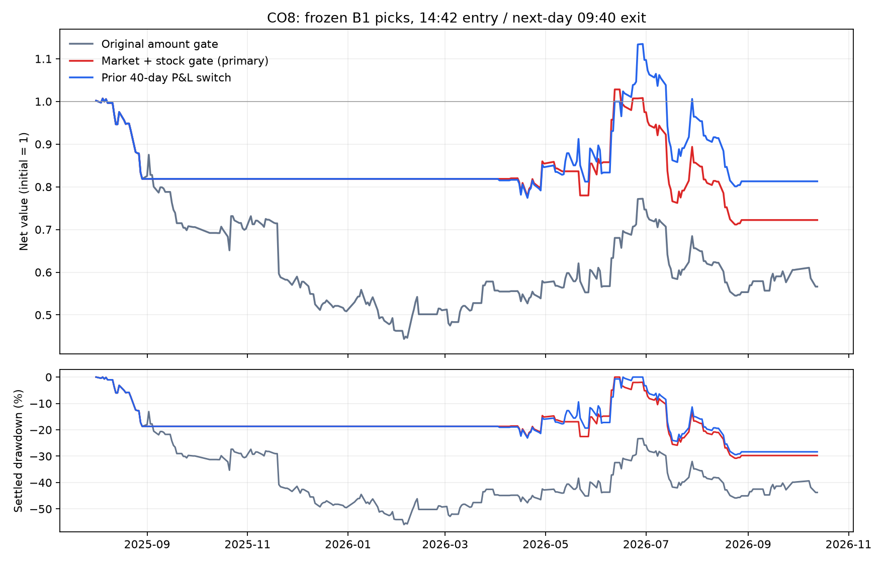

# CO8：固定 B1 的市场环境与个股状态交易判断

**本轮未达到“正收益且降低回撤”，不应升级交易策略。** 主方案保留82/222笔，净值−27.78%，结算回撤30.78%（原规则−43.37%/55.94%）；避开76笔亏损，其中32笔净亏超过2%，但也错过64笔盈利。留下交易的每笔净均值从−0.199%恶化为−0.344%，大亏比例从51/222（22.97%）变为19/82（23.17%）。主要变化是降低交易暴露，未显示选出更优交易。

更直接的对照是：原名单每笔统一使用36.94%资金（与主方案交易数占比一致），净值−16.51%、结算回撤25.24%，两项都优于主方案。逐月保持与主方案同样的交易笔数后随机删单，2,000次的净值中位数−27.06%，与主方案−27.78%相近；这只检验同月内选择，保留了原方案的月份开关，不能当作整个择时策略的独立显著性结论。固定市场单组为−14.84%，简单过去40日盈亏开关为−18.71%，也均未转正。

本段数据呈现明显的开关滞后：主方案在2026年2–3月和9月的盈利月份空仓，在7–8月亏损月份完全沿用原交易。不能因2025年部分月份被暂停而认为已经识别稳定的市场环境。主方案只在3/15月为正，另9个月完全空仓。

**与原先盈利的B1时间段分开看**：2026年2–7月同一91笔B1原规则，在本轮14:42入场及扣费口径下净收益+41.81%、结算回撤24.39%；主方案仅保留50笔，净收益+4.64%、结算回撤25.87%。因此本轮15个月整体为负，不能直接替代原B1特定区间的历史收益；新增开关在原盈利区间也没有改善风险收益。

可靠性检查：45个模型全部回读重评分误差0；第二层在相同NumPy/SciPy/pandas下分别用sklearn1.7.1和1.9.1独立拟合，分数和交易决定完全一致。预设2%哈希删样本概率在本批窗口中实际删了36/877个训练成员（4.10%，不重抽种子），导致10/288天的交易决定改变、2个月门槛改变，净值由−27.78%变为−33.12%。5日与10日配对块区间均跨零，尚不能证明主方案的收益改善可重复。详见[删样本检查](drop2pct_summary.json)、[版本复验](version191_summary.json)。

本轮固定 B1 名单，不重训第一层、不换股、不递补。主方案为原成交额门槛再叠加市场＋个股净收益评分；全部预设对照公开。历史已反复研究，本轮结果是时间外探索。

主口径：14:40 完结分钟生成输入，14:42 open 买入代理，次晨09:40 close 退出；初始10万元、全额现金、不借款，按金额扣双边佣金最低5元、过户费及卖方印花税。未计滑点的主结果和额外10bp情景分列。

|方案|交易笔数|净值收益%|结算最大回撤%|持仓分钟收盘回撤%|避开亏损|错过盈利|
|---|---:|---:|---:|---:|---:|---:|
|原成交额轮空|222|-43.37|55.94|58.41|0|0|
|成交额＋市场|95|-14.84|26.04|30.05|72|55|
|成交额＋个股|99|-26.35|33.06|38.75|68|55|
|成交额＋市场及个股（主方案）|82|-27.78|30.78|33.22|76|64|
|市场及个股替代成交额|94|-49.33|49.68|52.48|83|65|
|过去40日盈亏开关|98|-18.71|29.40|33.22|70|54|
|现金|0|0.00|-0.00|-0.00|127|95|

## 每月主方案与原成交额规则

按信号日月份归属；10月仅截至13日。回撤为本月信号对应持仓路径内的回撤，包含下一交易日结算，不是单笔收益简单累加。

|月份|原规则净收益%|主方案净收益%|原/新结算回撤%|原/新笔数|避亏/误拦盈利|
|---|---:|---:|---:|---:|---:|
|2025-08|-18.14|-18.14|18.70 / 18.70|18 / 18|0 / 0|
|2025-09|-13.79|0.00|20.20 / -0.00|17 / 0|12 / 5|
|2025-10|-0.59|0.00|7.86 / -0.00|13 / 0|9 / 4|
|2025-11|-18.73|0.00|22.03 / -0.00|16 / 0|13 / 3|
|2025-12|-10.85|0.00|13.80 / -0.00|19 / 0|12 / 7|
|2026-01|-8.97|0.00|17.20 / -0.00|19 / 0|8 / 11|
|2026-02|10.39|0.00|7.52 / -0.00|11 / 0|5 / 6|
|2026-03|9.07|0.00|7.38 / -0.00|14 / 0|5 / 9|
|2026-04|3.35|4.37|5.43 / 5.21|15 / 13|2 / 0|
|2026-05|4.68|0.02|10.97 / 9.18|13 / 5|3 / 5|
|2026-06|23.90|14.08|7.34 / 5.18|18 / 12|1 / 5|
|2026-07|-12.13|-12.13|21.81 / 21.81|20 / 20|0 / 0|
|2026-08|-15.68|-15.68|16.92 / 16.92|14 / 14|0 / 0|
|2026-09|9.55|0.00|4.30 / -0.00|12 / 0|4 / 8|
|2026-10|-6.57|0.00|7.25 / -0.00|3 / 0|2 / 1|

## 训练、可见性和核验

- 每月此前100个市场日，前60日拟合、后40日只选门槛，模型和门槛固定预测下一月。验证后不重拟合。所有训练标签成熟于验证首日14:40前，验证标签成熟于测试首日14:40前。
- 固定四项市场变量和五项个股变量；当日日线close/high/low等不进入特征，只使用滞后历史及T日已知preclose。市场快照只到14:40，个股路径严格截到14:40。
- 过去60日只拟合B1真实历史折外Top1；使用固定alpha=100的岭回归。±10%截断的净收益目标是稳健评分，不能当作已校准的真实期望收益。
- 预处理仅在训练内学习；不新增过滤、−0.5%/0%/0.5%评分门槛和现金均事先规定。验证以净值增长择门槛并限制回撤；交易样本不足15笔保持原规则。见[冻结设计](DESIGN.md)。
- 原CO7 288天股票和原成交额门槛逐行一致。45个模型重新加载，最大预测误差0。
- 与旧原始收益记录有0行相差超过1bp，全部见[input_reconciliation.csv](input_reconciliation.csv)。这类来源差异与门槛增益分开核查。
- 最终态分钟档案不能证明历史实时送达；数据库fetch_time另存[source_availability.csv](source_availability.csv)。14:42价格提供延迟代理，仍未证明涨跌停排队、整手、盘口容量和真实成交。
- 未来除权标志仅用于历史标签成熟后的训练及验证标签审计，不作为当日特征和测试交易筛选。本轮实际测试交易没有跨除权记录。冻结B1完整原始范围与CO7扩展范围沿用原标注。
- 结算回撤与持仓分钟close估值回撤分别列出；后者不包含分钟内高低及买卖盘口。少交易造成的机械降风险另与等平均仓位和逐月等笔数随机轮空对照。

## 配对不确定性与执行敏感性

|按交易日分块|主方案减基线的日均净收益差pp|95%区间pp|
|---|---:|---:|
|5|0.0556|[-0.2000, 0.3113]|
|10|0.0556|[-0.1994, 0.3170]|

区间来自固定策略同日收益差的4,000次配对分块重抽样，保留短期时间相关性；没有校正此前全部历史模型搜索，不能当作独立盲测显著性。

|执行价格|额外总摩擦bp|原规则净值%|主方案净值%|
|---|---:|---:|---:|
|reference|0|-44.63|-25.10|
|1441|0|-43.77|-25.62|
|1442|0|-43.37|-27.78|
|1442|10|-54.68|-33.49|

完整记录：[逐月](monthly.csv)、[总体及分年](summary.csv)、[执行敏感性](execution_sensitivity.csv)、[逐月验证选阈值](threshold_validation.csv)、[同等仓位及随机轮空](exposure_and_random_controls.json)、[审计](audit.json)。

本轮训练样本、每折划分、模型、全部验证与测试评分、原始输入哈希在 `outputs/stock_automl/b1_market_trade_gate_co8`。不因本轮历史结果自动修改线上策略。

复算入口：`scripts/experiment_b1_market_trade_gate_co8.py` 的 prepare/fit、`scripts/report_b1_market_trade_gate_co8.py`、`scripts/check_b1_market_trade_gate_co8.py`。首次全市场历史分钟准备耗时较长；411个逐日缓存已保存，后续研究可直接复用冻结样本。8项定向测试通过，覆盖当前/未来日线、14:40后分钟、重复/缺失分钟、标签成熟、训练预处理、验证门槛、费用及持仓回撤。

用户追加的开盘分布、轮动和资金分布方向，已完成库表与近五日时间字段核对，见[NEXT_FEATURES.md](NEXT_FEATURES.md)。这是下一轮候选设计，尚未训练；不混入本轮结果。盘中成交额分布可重建，日终主力资金流不得直接用作同日14:40因子。
