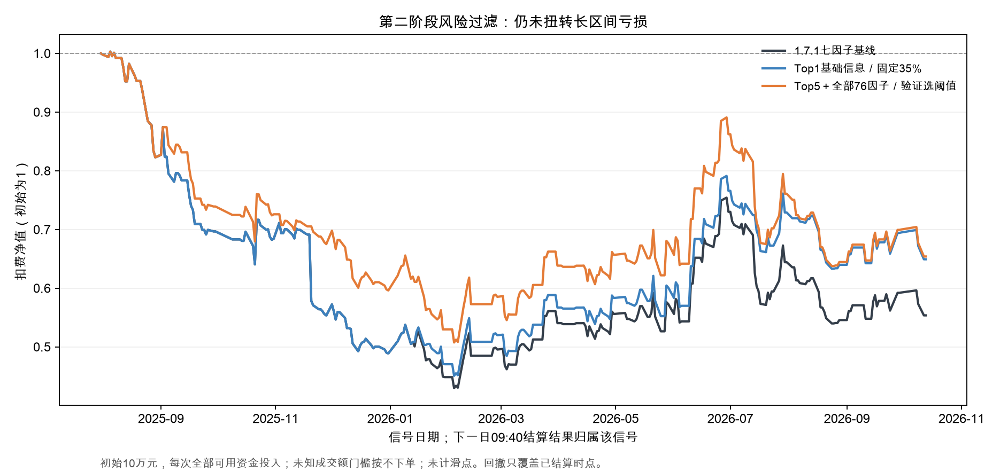

# CO7：原B1折外Top1/Top5的第二阶段大亏风险识别

## 结论

**已按新要求完成：只用第一阶段历史折外选择训练第二阶段，温和惩罚、时间验证、逐月冻结，原1.7.1七因子保留对照。** 本轮没有达到“2025、2026可检验月份中绝大部分盈利”。风险评分在原模型选中子集的AUC约0.56–0.60，但过滤没有把它转化成跨年稳定正收益。与CO6测试日期范围不同，不直接比较两轮AUC来证明模型进步。

本轮主要判断指标是**月净收益、最大回撤、大亏拦截、盈利误拦和剩余交易数**。删最好月/每月最好一笔只作压力测试，不作为必须通过的门槛。按这个放宽后的标准，仍未出现足够好的方案：15个测试月份只有6个月盈利；去掉4天的2026年10月后为6/14，2025年8–12月五个月全部亏损。

### 预设的四条“验证选阈值”主线

2025-08-01至2026-10-13，288个信号日。下表净值按初始10万元、每笔全部可用资金投入、次晨退出再开下一笔计算；含佣金、印花税和过户费，不含滑点。**最大回撤是净值相对历史峰值的比例，非单笔收益累加回落；只覆盖已结算时点，未覆盖持仓中的收盘/盘中峰谷。**

| 方案 | 保留笔数 | 拦住大亏 | 误拦盈利 | 净值总收益% | 最大回撤% | 正收益月/日历月 |
| --- | --- | --- | --- | --- | --- | --- |
| 1.7.1七因子基线 | 222 | 0 | 0 | -44.63 | 57.16 | 6/15 |
| Top1基础信息／验证选阈值 | 222 | 0 | 0 | -44.63 | 57.16 | 6/15 |
| Top5基础信息／验证选阈值 | 214 | 2 | 3 | -42.70 | 57.68 | 6/15 |
| Top5＋8项走势／验证选阈值 | 218 | 1 | 3 | -40.20 | 52.39 | 6/15 |
| Top5＋全部76因子／验证选阈值 | 217 | 2 | 2 | -34.60 | 49.40 | 6/15 |

全部76因子自适应方案保留217/222笔，拦住2笔大亏、误拦2笔盈利和1笔其他交易，净值由−44.63%改善到−34.60%，最大回撤由57.16%降至49.40%。但改善主要来自避开2025-11-20一笔−16.35%的交易；两条冻结路径同时去掉该日后，基线净值收益为-33.81%，过滤方案为-34.60%，优势不再存在。这个归因检查不构成新的选股规则，也不是必须剔除单笔才能合格的门槛。

## 1. 确保研究的是原B1的错误

- 原B1的七因子、四类、前20个市场交易日每日重训、类别优先顺延规则不变，锁定scikit-learn1.7.1。
- 2026年原118个预测日，224条Top2选择/类别全部一致，概率最大差小于1e−16；2025年3–8月232条、9–10月75条官方冻结Top2也全部一致，概率差为0。已核对官方最终连续母表结果，未把旧的中间回放文件当权威基准。
- 2025-02-05至11-03、2026-01-05至07-31保留原冻结候选和基础模型标签；其余日期按原B1的历史复权日线MA和股本代理定义扩展。扩展期采用CO4已核验的分钟完整性与候选池，**不称整段历史都是原来保存的B1预测**。原2–7月的同口径身份已实际复现。
- 第一阶段共408天、147,152条候选概率、1,868条最多Top5折外记录。每一条预测都来自当时仅看此前20日的模型，不使用该模型在自己拟合数据中的排名。
- 原输入快照两个终点日当时没有次晨文件，只补终点标签供之后的日期训练；原冻结区间所有已有预测均不受影响。

## 2. 第二阶段如何隔离训练与验证

每个测试月，取此前100个第一阶段折外市场日：前60日拟合风险模型，后40日独立验证阈值；冻结参数后用过去100日重新拟合，预测下一月。标签必须在下一阶段首日14:40前成熟。截尾、填充、标准化只在对应训练段估计。

比较四种输入：Top1原7因子＋基础预测信息14项；Top5同14项；Top5再加8项业务走势共22项；Top5全部76因子＋基础预测信息共83项。基础预测信息包括四类概率、概率领先幅度、当日合格候选数及排名。模型均为C=.03的强正则逻辑回归，按日等权，无严重类三倍训练权重。

标签为扣费后的09:40价格收益严格小于−2%。Top5仅扩大训练样本，**交易只过滤原Top1，不递补、不重新排序**。每条模型保留35%、50%固定阈值对照；自适应方案只在过去验证Top1上从35/40/45/50/60%和不拦截中选择，评分为“拦住大亏×1.5−误拦盈利−其他拦截×0.25”，验证至少15笔、保留≥70%、误拦盈利≤20%，并须优于不拦截。验证证据不足就关闭过滤。约束不保证下一月仍能满足。

15个月中，自适应规则启用月份分别为：Top1基础1，Top5基础3，Top5＋走势8，Top5全因子7；其余月份保持原交易。Top1发现期通常只有约60条记录，识别能力有限，不能把关闭过滤说成风险模型成功。

固定方案见运行前提交 [DESIGN.md](DESIGN.md)，每月阈值候选/选择与验证计数见 [validation_thresholds.csv](validation_thresholds.csv)。阈值与拟合使用不同历史样本的方法依据见 [scikit-learn阈值文档](https://scikit-learn.org/stable/modules/classification_threshold.html)，本轮实际运行仍为1.7.1。

## 3. 拦截效果与固定阈值对照

基线222笔已完成交易，其中51笔净亏>2%，94笔盈利。下表展示基线、预先固定的Top1 35%门槛以及全因子自适应方案；其余结果全部列于下一张表，不择优隐藏。

| 方案 | 共拦截 | 拦住大亏 | 大亏召回% | 误拦盈利 | 盈利误拦% | 留下交易大亏% | 大亏AUC |
| --- | --- | --- | --- | --- | --- | --- | --- |
| 1.7.1七因子基线 | 0 | 0 | 0.00 | 0 | 0.00 | 22.97 | — |
| Top1基础信息／固定35% | 6 | 3 | 5.88 | 2 | 2.13 | 22.22 | 0.565 |
| Top5＋全部76因子／验证选阈值 | 5 | 2 | 3.92 | 2 | 2.13 | 22.58 | 0.556 |

Top1固定35%拦6笔，3笔大亏、2笔盈利，保留216笔；它在2025年没有拦截任何交易，改善集中于2026年。Top5加更多因子并未稳定优于少因子。固定50%多数时候几乎不拦截；35%筛得更严时，误拦盈利会增加，未解决跨年收益问题。全因子自适应拦2笔大亏，同月随机拦同数量的期望约0.96笔；只有5笔被拦，不能据此证明可靠显著优势。

| 方案 | 保留笔数 | 拦住大亏 | 误拦盈利 | 净值总收益% | 最大回撤% | 正收益月/日历月 |
| --- | --- | --- | --- | --- | --- | --- |
| 1.7.1七因子基线 | 222 | 0 | 0 | -44.63 | 57.16 | 6/15 |
| Top1基础信息／固定35% | 216 | 3 | 2 | -35.08 | 55.06 | 6/15 |
| Top1基础信息／固定50% | 222 | 0 | 0 | -44.63 | 57.16 | 6/15 |
| Top1基础信息／验证选阈值 | 222 | 0 | 0 | -44.63 | 57.16 | 6/15 |
| Top5基础信息／固定35% | 203 | 6 | 8 | -35.94 | 57.68 | 6/15 |
| Top5基础信息／固定50% | 222 | 0 | 0 | -44.63 | 57.16 | 6/15 |
| Top5基础信息／验证选阈值 | 214 | 2 | 3 | -42.70 | 57.68 | 6/15 |
| Top5＋8项走势／固定35% | 184 | 8 | 20 | -47.84 | 52.55 | 5/15 |
| Top5＋8项走势／固定50% | 213 | 1 | 6 | -43.17 | 58.58 | 6/15 |
| Top5＋8项走势／验证选阈值 | 218 | 1 | 3 | -40.20 | 52.39 | 6/15 |
| Top5＋全部76因子／固定35% | 176 | 10 | 24 | -45.90 | 50.71 | 5/15 |
| Top5＋全部76因子／固定50% | 203 | 4 | 11 | -43.08 | 56.98 | 6/15 |
| Top5＋全部76因子／验证选阈值 | 217 | 2 | 2 | -34.60 | 49.40 | 6/15 |

## 4. 分年与原B1共同区间

2025这里只含8–12月；2026含1–9月及10月4日，范围不同，不能将两年总收益直接当同长度年化结果。

| 方案 | 年份 | 笔数 | 每笔净均值% | 净值收益% | 最大回撤% | 正收益月份 |
| --- | --- | --- | --- | --- | --- | --- |
| 1.7.1七因子基线 | 2025 | 83 | -0.81 | -51.12 | 51.26 | 0/5 |
| 1.7.1七因子基线 | 2026 | 139 | 0.15 | 13.28 | 28.41 | 6/10 |
| Top1基础信息／固定35% | 2025 | 83 | -0.81 | -51.12 | 51.26 | 0/5 |
| Top1基础信息／固定35% | 2026 | 133 | 0.27 | 32.82 | 19.98 | 6/10 |
| Top5＋全部76因子／验证选阈值 | 2025 | 80 | -0.62 | -40.38 | 40.56 | 0/5 |
| Top5＋全部76因子／验证选阈值 | 2026 | 137 | 0.13 | 9.70 | 28.41 | 6/10 |

原B1的2026年2–7月118日单独核对：

| 方案 | 笔数 | 大亏笔数 | 每笔净均值% | 净值收益% | 最大回撤% | 正收益月份 |
| --- | --- | --- | --- | --- | --- | --- |
| 1.7.1七因子基线 | 91 | 19 | 0.47 | 43.63 | 24.23 | 5/6 |
| Top1基础信息／固定35% | 89 | 18 | 0.56 | 54.92 | 16.42 | 5/6 |
| Top5＋全部76因子／验证选阈值 | 91 | 19 | 0.47 | 43.63 | 24.23 | 5/6 |

原B1该段仍有较好收益；新宽因子自适应门槛在这段没有拦截，不能把原收益当成二阶段贡献。Top1固定35%在同段有改善，但2025年没有相应泛化。原B1旧报告+57.61%未扣费；此处+43.63%按本轮全额现金投资、逐笔扣费口径算，不应混用。

## 5. 逐月净值收益

收益按信号月份归属，即该月信号对应的下一交易日09:40结算收益。10月只有4个信号日，单列为不完整月。每月笔数、月内回撤、大亏/误拦以及全部13条方案见 [逐月精简.csv](逐月精简.csv)；[monthly.csv](monthly.csv)为程序完整指标。

| 月份 | 七因子基线% | Top1固定35% | Top5全因子验证选阈值% |
| --- | --- | --- | --- |
| 2025-08 | -17.71 | -17.71 | -17.71 |
| 2025-09 | -15.33 | -15.33 | -10.17 |
| 2025-10 | -1.79 | -1.79 | -1.79 |
| 2025-11 | -19.10 | -19.10 | -7.00 |
| 2025-12 | -11.69 | -11.69 | -11.69 |
| 2026-01 | -8.24 | -3.74 | -11.14 |
| 2026-02 | 10.48 | 10.48 | 10.48 |
| 2026-03 | 9.08 | 9.08 | 9.08 |
| 2026-04 | 2.88 | 2.88 | 2.88 |
| 2026-05 | 3.03 | 3.03 | 3.03 |
| 2026-06 | 27.43 | 27.43 | 27.43 |
| 2026-07 | -11.76 | -4.82 | -11.76 |
| 2026-08 | -15.29 | -12.22 | -15.29 |
| 2026-09 | 8.61 | 8.61 | 8.61 |
| 2026-10 | -6.58 | -6.58 | -6.58 |

“绝大多数月份盈利”可以作为候选策略的重要条件，并不要求每月删掉最大盈利后还赚钱。但还须同时看亏损月份的幅度、净值回撤、交易数量、费用和未来时间验证。本轮2025五个月连续亏损、全期净值为负，尚不需要依靠删最大盈利的严格压力测试才能判断不合格。

## 6. 集中度压力测试（辅助，不作硬门槛）

最好月按原每月净收益之和确定，三条展示方案均为2026年6月。删除指定交易后持有现金，其他选择/模型不变；不重选阈值。

| 方案 | 压力测试 | 剩余笔数 | 每笔净均值% | 净值收益% | 最大回撤% |
| --- | --- | --- | --- | --- | --- |
| 1.7.1七因子基线 | 删最好月 | 204 | -0.36 | -56.55 | 57.75 |
| 1.7.1七因子基线 | 每月删最好一笔 | 207 | -0.67 | -77.18 | 77.25 |
| 1.7.1七因子基线 | 两者都删 | 190 | -0.81 | -79.98 | 80.04 |
| Top1基础信息／固定35% | 删最好月 | 198 | -0.29 | -49.05 | 55.06 |
| Top1基础信息／固定35% | 每月删最好一笔 | 201 | -0.61 | -73.24 | 73.32 |
| Top1基础信息／固定35% | 两者都删 | 184 | -0.75 | -76.52 | 76.59 |
| Top5＋全部76因子／验证选阈值 | 删最好月 | 199 | -0.29 | -48.68 | 50.10 |
| Top5＋全部76因子／验证选阈值 | 每月删最好一笔 | 202 | -0.61 | -72.64 | 72.72 |
| Top5＋全部76因子／验证选阈值 | 两者都删 | 185 | -0.74 | -75.99 | 76.06 |

所有方案的全期、分年、完整月、B1共同期压力结果见 [stress.csv](stress.csv)。最大避损的归因检查另存于 [largest_avoided_loss_attribution.csv](largest_avoided_loss_attribution.csv)。

## 7. 资金、未知数据与适用边界

- 单笔收益及大亏标签按5万元成交额计算；佣金万2.5双边且每侧最低5元，过户万0.1双边，印花税万5卖方。净值模拟每次先扣买入费用，剩余金额买入，不借款；退出再扣卖出费用。忽略整手、涨跌停真实成交约束、冲击和资金容量。费用为统一研究假设，不等于具体账户账单。
- 最大回撤是100%资金投入假设下的已结算交易净值回撤。低仓位会降低账户回撤，也会缩小收益，不能借仓位缩小把负期望变为正期望。完整指标另保留额外总10bp滑点情景。
- 资料不足的成交额门槛按不下单处理，原始未知仍保留字段，原B1的4个未知门槛没有补成已知通过/失败。实际入选且允许交易的未知卖价为0，因此本轮这些净值序列完整；若出现未知退出，代码会停止给出完整净值/回撤，不用零收益穿过去。
- 本轮基线实际222笔交易没有跨日除权标记。历史1,868条TopK训练候选中8条带除权标记，4条按价格口径落入大亏；当前标签仍为未复权价格扣费收益，未还原分红送转权益，个别训练标签可能与经济盈亏不同。该限制不能用于声称模型已经识别真实账户大亏。
- 2025早期用于第一阶段预热及二阶段训练/验证，不能伪造从1月起就有已训练的风险模型。2026-10-13行情覆盖弱于常规日期，延续CO4披露。整个历史区间已反复研究，本轮严格前推仍不是全项目全新盲测。

## 8. 判断与保留资产

本轮在B1折外选中子集中学风险，温和门槛保留了较多交易。但大亏召回仍低，扩大拦截又会损失盈利，2025持续亏损未被修复。**保留研究代码与原B1，不升级为交易策略。** 后续若继续，重点应转向“B1在什么历史可观察的环境下有交易优势”，并区分普通小亏累积与极端大亏；不能只调风险阈值期待消除所有负收益月份。

核验见 [audit.json](audit.json)：408个第一阶段模型、120个第二阶段模型包的日期和哈希检查通过；所有120个二阶段模型重开，验证及测试概率误差0；原2025/2026冻结预测逐项匹配。23项定向测试通过，未跑无关全仓库测试。第一阶段155,027行曾进入拟合，第二阶段1,752条独立折外候选曾进入拟合，逐折名单与权重全部保存。

训练入口：[experiment_automl_close_open_conditional_b1.py](../../../scripts/experiment_automl_close_open_conditional_b1.py)；源提交与哈希见 [run_manifest.json](run_manifest.json)。数据、模型、逐日及逐月证据保留在 `outputs/stock_automl/close_open_conditional_b1_r1`。独立研究包生成后登记本地镜像与数据库；以archive_receipt.json记录最终文件数、哈希和ZIP回读。用户要求暂缓云盘上传，旧CO4/CO5/CO6包保持原样。
