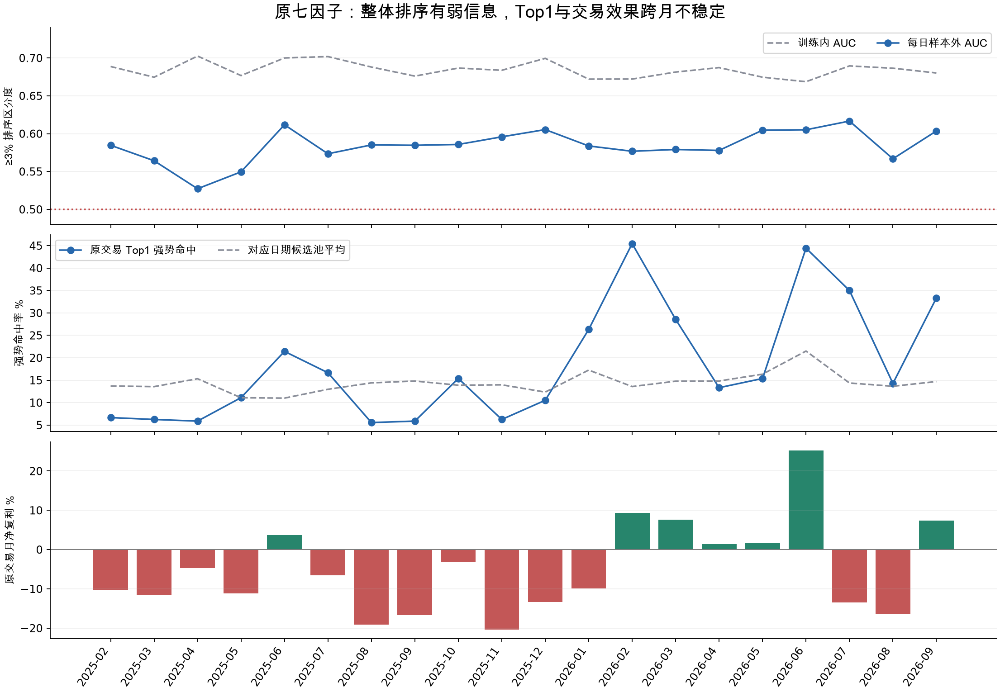

# CO22：原七因子模型还有多少预测价值

**判断：有较弱的样本外排序信息，值得保留作研究对照和辅助评分；现有证据不支持把它当作稳定的独立Top1交易模型。** 这不是单纯延长时间后所有预测能力消失：20个月每月的日均强势目标AUC都略高于0.5；但最前一名的效果在2025/2026明显分化，强势机会增多还伴随更大的下跌风险。原目标只区分价格档位，没有直接优化09:40净收益和亏损幅度。

身份边界：本次对象是CO7/B1R可重放原七因子滚动模型；ACTIVE登记的+97.02%历史冻结名单是另一份结果资产，不能将本轮扩展收益直接冒充它的延长曲线。2026年2—7月原共同区间单独核对，且下面明确区分原模型与后加门槛。

本轮只诊断已保存模型，没有训练新策略或调新阈值。sklearn1.7.1下回读408个原七因子20日滚动模型、逐折训练成员和147,152行全部候选预测，重算概率最大误差0；147,025个有标签样本与独立次晨第二高价全部相同。主观察期2025-02-07—2026-09-30为404个预测日、145,932个有标签样本、397个Top1、308笔原成交额门槛后的交易；10月4个预测日单列。原2026年2—7月118日单列核对。见[设计](DESIGN.md)、[模型核对](model_verification.csv)、[总核验](verification.json)与[独立指标复算](metric_crosscheck.json)。

## 早期“效果不错”具体是什么

最初[2026-10-10四分类报告](../20261010_second_high_four_class/README.md)的20个9月样本外日，强势目标AUC是0.614（日均），训练内0.684；四类平衡准确率约0.272（日均，随机为0.25）。整体≥3%排序AP为0.164，基率0.119。这代表弱排序信息，原报告本身已指出四分类识别弱。更大容量树的训练AUC升到0.990，次日却降到0.570，说明单纯增加模型容量没有在那批数据中解决问题。它的候选池是早期版本，不能把这20天当作当前B1R全年同输入测试。

后来的[原B1 2026年2—7月](../20261011_mk_1m_tradable_st_rolling20/README.md)，115个未加成交额门槛的Top1，09:40毛复利只有+6.46%；再加入[看过历史结果后发现的个股成交额条件](../20261011_market_state_asof/README.md)，91笔毛复利才达到+57.61%。按本轮买卖各0.1%统一费用，两者为−15.41%和+31.38%。因此+57.61%是特定区间模型、头部选择和后加门槛共同形成的历史收益，不能等同于模型分类很准；这段又参与过研究及门槛发现，不是全新盲测。

## 对原target的识别确实不强，但也不是纯随机

|主区间指标|训练内逐折平均|样本外逐日平均|
|---|---:|---:|
|第二高价≥3% AUC|0.685|0.584|
|第二高价≥1% AUC|0.640|0.536|

AUC=0.5代表该二元目标没有排序优势，AUC=0.584不是58.4%的胜率。按月成块重采样，日均强势AUC的描述性95%区间约[0.574,0.593]，支持这批历史存在弱排序信息；无法消除既往研究选样和规则选择的影响。原策略308笔交易中178笔来自预测`1–3%`档的顺延排序，因此≥1%能力接近随机同样重要。

全部样本外候选的四类准确率33.22%，逐折训练多数类常数预测31.10%，仅高2.12个百分点；四类平衡准确率28.04%。≥3%类按最大概率直接判出的召回率只有1.54%，但这个数受类别不平衡和argmax决策影响，不能单凭召回率判断排序是否有效。全部候选对数损失1.3539，比过去20日类别频率常数预测1.3608略好；**原收益最好的2—7月区间反而是1.3703对1.3674，模型略差**，与旧A3审计一致。逐月与各段全部指标见[classification.csv](classification.csv)，训练内样本跨滚动窗口重复，不能当作独立样本累计。

## 时间变化主要打在Top1及收益上

以下Top1都已通过原成交额门槛；“同日池”是仅在这些交易日期内，对当日候选实际强势比例取平均，作为描述性对照，并非可用未来标签的交易规则。

|区间|日均强势AUC|原交易笔数|Top1强势命中|对应同日池强势比例|原净复利|
|---|---:|---:|---:|---:|---:|
|2025-02—07|0.568|89|11.24%|13.16%|−35.00%|
|2025-08—12|0.592|83|8.43%|13.86%|−54.94%|
|2026-01—06|0.588|90|28.89%|16.74%|+36.75%|
|2026-07—09|0.596|46|28.26%|14.24%|−22.40%|

整体排序能力差不多，2025年Top1却没有强势富集，2026年有富集也不保证收益。全期交易Top1强势命中18.18%，对应同日池14.55%，优势3.63个百分点；按月块重采样95%区间约[−1.39,+9.11]个百分点，未形成稳定头部优势。Top1模型平均给出的强势概率24.61%，高于实际18.18%；2025下半年平均预测20.31%，实际只有8.43%，高分端明显不可靠。置信区间只是已研究历史的描述，不是未来保证。见[逐月Top1](top1.csv)、[原选股分支](selection_branches.csv)、[不确定性](uncertainty.json)。

## 高强势分数也筛进更大下跌风险

按每天所有候选的`P(≥3%)`排序再分十分位，既不调阈值也不换原名单：

|每天分数层|实际次高≥3%|实际次高<0%|09:40净亏>2%|09:40每笔净均值|
|---|---:|---:|---:|---:|
|最低10%|8.90%|28.42%|10.52%|−0.12%|
|最高10%|20.66%|36.77%|28.72%|−0.39%|

强势概率排序确有富集，却同时富集严重亏损；这与模型部分识别较大波动、而非单纯上涨方向相符，不能据此断言全部原因就是波动。四分类把−1%和−15%放在同一个低档，也把+3%和+20%放在同一个高档；分类损失和类别优先排序不能直接表达这些经济损失差异。见[逐月/各段十分位](score_deciles.csv)。

## 目标兑现有差距，最大的损失来自未命中的交易

原308笔按**事后真实target**分组（用于解释损失，不是可事前使用的过滤规则）：

|真实次高价档位|笔数|09:40净均值|净亏>2%笔数|
|---|---:|---:|---:|
|<0%|100|−3.05%|62|
|0%—<1%|57|−0.75%|4|
|1%—<3%|95|+0.34%|2|
|≥3%|56|+3.81%|0|

56笔真正强势中52笔到09:40仍净赚，只有4笔净亏；所以不能将当前失败主要归为“target命中了却卖不出来”。但95笔1%—3%标签里37笔到09:40净亏，目标与退出也确有差异。最主要损失是100笔target<0%的误选，平均净亏3.05%，覆盖了68笔严重净亏中的62笔。

2026年7月尤其说明问题：20笔交易里7笔次高≥3%（35%，明显超过同日池14.38%），但另7笔次高<0%的交易平均净亏4.02%，全月仍−13.47%。因此只提高达标比例或继续加外部轮空，未必能解决盈利和尾部损失不对称。见[真实target与卖出关系](target_bridge.csv)、[逐月损失拆解](loss_attribution.csv)。

## 研究价值与限制

保留原七因子/1.7.1模型作为可复现对照及弱排序信号有价值；将它当成已被长期验证的独立Top1选股器则证据不足。下一步若做模型研究，应同时验收强势富集、与09:40净收益有关的损失幅度及月度稳定性，而不是只优化训练分数或单一命中率。旧CO7等二阶段风险实验已经试过且未稳定通过，所以这不是“再加一个风险头就一定能解决”的结论。本轮没有重新选模型或生产替换。

**CO21日期计数勘误：**其2025-02—07输入取自117个有Top1的日期，漏列2025-04-07、06-13、07-09三个模型无Top1日。完整早期预测日为120，至2026-09全期为404，而非此前报告401；397个Top1、308笔交易和所有逐月/总体收益不变。CO21原不可变包保留，当前勘误和完整日期以本报告及fold_diagnostics.csv为准。

运行：`.venv-automl/bin/python -m scripts.audit_b1_model_value_co22 --source <CO7完整运行目录>`。全部候选与训练先验保存在`outputs/stock_automl/b1_model_diagnostic_co22_20261026/oof_predictions.csv.gz`；原模型和实际训练样本沿用已归档CO7，逐折哈希在本报告保存。研究包先留本地，云端待同步，归档回执另存本目录。
