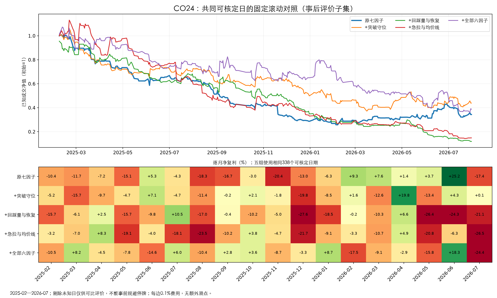

# CO24：六个条件因子加入原七因子，首轮滚动实验

开始2026-10-26，完成2026-10-27。**本轮没有找到可升级的组合。** 突破守位组在2025年有减亏，但2026年失去原模型的盈利；回踩组、持续性组和全部六因子未改善跨月效果。经验能写成变量，不代表直接加入原四分类树就有增量。本轮不接入生产，不改ACTIVE历史冻结基准。

## 固定比较与实际覆盖

按[结果前方案](DESIGN.md)，原CO7/B1R候选与七因子不变；六变量按[CO23设计](../20261026_b1_douyin_factors_co23/SIX_FACTOR_DESIGN.md)从分钟路径重新计算。137,833条候选、382个信号日，原买价全部一致，未因缺失删行。预测2025-02-07—2026-07-31共362日、18月。每折使用原20日训练成员、成熟标签、相同HGB参数和sklearn1.7.1；五组共1,810模型。固定各组，不根据2026结果选参数。

语义仍是收盘附近信号、开盘阶段退出；首轮沿用旧14:40/次晨09:40价格代理以隔离因子影响，并非锁定未来执行时间。费用每边0.1%，无额外滑点，回撤只计结算点。2025上半年用于单因子分组边界发现，下半年固定验证，2026-01—07顺序评估；历史已反复研究，不能称最终盲测。8—9月旧缓存没有构造全部候选前20日同钟点量所需的全市场分钟，暂不混源扩展。

## 必须先说明未知门槛与停牌

原成交额门槛要求前20个市场交易日均有记录。五组分别有14/12/11/12/7个Top1日无法核定门槛，均未改成确定轮空或零收益。**C/E还选中2025-08-19的300486，次日无分钟交易，日线连续零成交量支持停牌判断，无法在约定开盘阶段卖出。** 本轮没有补做延期卖出和资金占用模拟。

因此下列全样本复利是**已知可核定交易部分的连乘**，不是已经修复停牌/未知门槛的完整可执行账户收益，尤其C/E后续资金占用未知。全部缺口见[未知决策](unknown_decisions.csv)、[停牌核查](suspension_observation.json)。另做五组共同可核定338日的比较，结论不变；该事后评价子集不能事前规避停牌，也不是新交易规则。

## 全部18个月：可核定交易部分

|方案|已知交易|净复利%|结算回撤%|强势命中%|净亏>2%占比|盈利月/18|门槛未知|退出未知|
|---|---|---|---|---|---|---|---|---|
|原七因子|282|-65.34|74.98|17.73|21.28|6|14|0|
|+突破守位 S1/S2|290|-54.84|66.26|19.31|20.69|5|12|0|
|+回踩缩量/恢复 S3/S4|275|-87.82|87.82|16.36|29.45|4|11|1|
|+急拉/均价线 S5/S6|290|-82.90|86.03|16.21|27.59|4|12|0|
|+全部六因子|299|-68.63|72.89|18.73|27.09|6|7|1|

只加突破守位从−65.34%减至−54.84%，但仍亏且只5/18月盈利；不能因为少亏就判为有效。全部六因子强势命中略提高，大亏占比却从21.28%升到27.09%，没有解决原来的尾部问题。

## 2026年前七个月：原模型盈利的时期，新因子没有守住

|方案|交易|已知交易净复利%|结算回撤%|强势命中%|净亏>2%占比|盈利月/7|门槛未知|
|---|---|---|---|---|---|---|---|
|原七因子|110|18.33|25.26|30.00|20.91|5|4|
|+突破守位 S1/S2|114|-4.76|32.25|27.19|22.81|3|3|
|+回踩缩量/恢复 S3/S4|109|-64.89|65.15|21.10|33.03|2|0|
|+急拉/均价线 S5/S6|111|-49.62|55.76|20.72|28.83|2|2|
|+全部六因子|122|-45.98|60.77|21.31|30.33|2|1|

同一时期五组都可核定的132个日期如下。排除日期是为了事后可比评价，不代表当时可预知并规避；完整共同日期见[范围](common_known_scope.json)。

|方案|交易|共同日期净复利%|结算回撤%|强势命中%|净亏>2%占比|
|---|---|---|---|---|---|
|原七因子|107|19.80|25.26|29.91|20.56|
|+突破守位 S1/S2|110|-11.97|32.35|26.36|22.73|
|+回踩缩量/恢复 S3/S4|105|-65.81|66.06|20.00|32.38|
|+急拉/均价线 S5/S6|106|-55.07|58.65|18.87|29.25|
|+全部六因子|117|-40.36|54.99|20.51|29.06|

## 逐月净复利（已知交易部分，%）

下表保留全日历与原名单；2025-08的C/E含上述停牌缺口，若按一份资金实际持仓，后续账目还需延期退出重算。其他含门槛未知的月份也不作为完整账户结论。每月交易数、命中、大亏、未知数量见[monthly.csv](monthly.csv)；五组共同日期的月表另见[common_known_monthly.csv](common_known_monthly.csv)。

|月份|原七因子|+突破守位 S1/S2|+回踩缩量/恢复 S3/S4|+急拉/均价线 S5/S6|+全部六因子|
|---|---|---|---|---|---|
|2025-02|-10.36|-5.23|-15.72|-3.15|-10.47|
|2025-03|-11.65|-15.70|-6.09|-7.03|+8.15|
|2025-04|-4.72|-11.14|+0.86|+6.54|-4.52|
|2025-05|-11.10|-6.95|-15.65|-19.06|-11.68|
|2025-06|+3.69|+7.43|-9.65|-3.96|-14.56|
|2025-07|-6.54|-4.66|+11.68|-13.66|+0.53|
|2025-08|-19.15|-12.36|-17.02|-24.25|-10.38|
|2025-09|-16.73|-0.24|-0.39|-10.19|+0.77|
|2025-10|-3.04|+2.09|-10.20|+3.80|+3.62|
|2025-11|-20.36|-1.78|-4.95|-4.65|-8.75|
|2025-12|-13.32|-20.08|-27.61|-21.70|-3.04|
|2026-01|-9.93|-13.66|-21.67|-9.08|+14.07|
|2026-02|+9.30|+7.75|+5.92|+0.90|-13.83|
|2026-03|+7.59|-12.55|-15.15|-10.66|-13.95|
|2026-04|+1.37|+19.78|+6.58|+4.86|-2.86|
|2026-05|+1.73|-6.08|-21.67|-18.87|-26.48|
|2026-06|+25.20|+4.32|-24.25|-6.25|+18.33|
|2026-07|-13.47|-0.26|-21.12|-22.93|-24.41|

## 去掉高收益月份/单笔，以及换股造成的代价

仍基于上述已知部分做压力测试，不改变实际选股。删每月最好盈利一笔只作辅助。

|方案|最好月份|去最好月净复利%|每月去最好盈利单后%|
|---|---|---|---|
|原七因子|2026-06|-72.32|-87.95|
|+突破守位 S1/S2|2026-04|-62.30|-84.56|
|+回踩缩量/恢复 S3/S4|2025-07|-89.09|-96.14|
|+急拉/均价线 S5/S6|2025-04|-83.95|-94.04|
|+全部六因子|2026-06|-73.49|-91.64|

|方案|原大亏未再交易|原盈利未再交易|不同于原方案的新交易|新交易中大亏|
|---|---|---|---|---|
|+突破守位 S1/S2|33|48|146|33|
|+回踩缩量/恢复 S3/S4|36|83|192|57|
|+急拉/均价线 S5/S6|39|69|190|59|
|+全部六因子|48|87|248|69|

这里是重新排序导致换股，**不是二阶段过滤**。例如突破组避开33笔原大亏，却又选进33笔新的大亏；不能只报告“拦住多少”。E原大亏未保留48笔，但新增69笔大亏，说明换掉坏股票不等于找到好股票。新交易统计含尚未知退出的持仓时须结合unknown_decisions查看。

## 单因子还有什么值得保留

用2025上半年25%/75%分位数固定分组，在两组都有样本的相同日期等权比较。此处是全候选关联，非交易模型成绩，未据2026结果修改方向、分界或选股。见[边界](factor_group_rules.csv)、[分组逐月结果](factor_groups.csv)、[旧因子相关性](factor_redundancy.csv)。

- **S3回踩相对量能**：2026年低组每笔净均值−0.290%、高组−0.393%；大亏22.58%对23.43%。缩量回踩有轻微减亏关联，但两组均亏，强势率未增加；不能称它已经找到盈利规律。
- **S6均价线承接**：高组2026年大亏22.36%，低组26.13%，平均净收益−0.340%对−0.420%；但强势率从17.92%降到15.49%。更像风险相关变量，且与已有日内VWAP距离Spearman相关约0.69，增量未确认。
- **S4回踩恢复**：高恢复组2026年净均值反而约低0.115个百分点，强势率低约1.48个百分点，与旧末30分钟位置相关约0.57。对已涨3%—6%的候选而言，恢复可能已体现在更高买价中；这是解释假设，不能据此断言恢复本身有害。
- **S5急拉集中**与旧末5分钟收益相关约0.64，没有清晰独立风险优势；模型加S5/S6后明显退步。
- **S1站稳比例**在发现段25%/75%分位都为0，没有强行改阈值造分组；仍作为连续变量完整进入B/E模型。S2突破失守加大时大亏更高，但强势率也可能更高，不能机械转成单向买卖规则。

18个月按月等权的日均强势AUC：A约0.5840、B约0.5840、C约0.5832、D约0.5833、E约0.5812。即全候选排序没有明显加强，Top1波动及经济损失仍是核心问题。以上不是经多重检验确认的显著性结论。

## 数据完整性、验证与归档

S1/S6各137,833条可计算；S2为38,744条发生过突破的候选；S4为117,662条有可定义回踩，S3为116,763条，其中899条回踩缺完整/正值的历史钟点量基线；S5有137,816条存在正向价格变化。没有形态与资料不足均审计记录，模型原生处理NaN，不删原候选。所有候选当前分钟路径齐全、买价一致。

8项因子公式/边界测试通过；120条抽样以独立标量公式复算、120组历史压力位/ATR以反向价格换算复算，全部一致。362折七因子重训概率与CO7原全候选一致；1,810模型全部回读概率一致；90个逐月资金计算独立复算通过。见[特征核验](feature_verification.json)、[运行核验](verification.json)。未运行与本研究无关的全仓库应用测试。

代码：`scripts.research_b1_six_factors_co24`的build/train；训练可用`--shard 0/2`及`1/2`并行。结果由`analyze_b1_six_factors_co24`生成，特征独立复核用`verify_b1_six_factors_co24`。实际面板、路径、成员、模型和全候选预测位于`outputs/stock_automl/b1_six_factors_co24_20261026`。原模型父资产CO7已登记，ACTIVE最佳历史拼接名单不等同于本轮A7扩展曲线。

完整研究包按既有规约本地保留、登记数据库，回执另存本目录；云端遵照用户要求待同步，不能称已完成云盘归档。

**结论：六个变量可以算、可以训练，但本次直接加入原七因子分类树没有带来可靠提升。** 保留定义和失败证据，S3/S6仅保留为风险关联线索；不继续根据已看过的2026结果拼阈值，不宣称加因子就解决模型问题。
