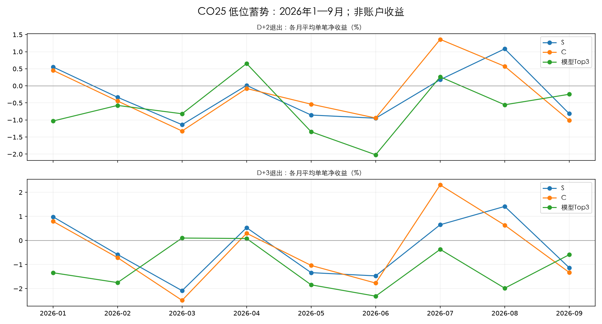

# CO25：低位蓄势规则与2/3日预测

2026-10-27。用户要求换一个方向：先框定低位蓄势股票，再观察2/3日涨幅。本轮为独立日线研究；以下结果均为事件/单笔参考收益，不是B1升级或账户回测。

**结论：这组规则尚未形成稳定上涨优势，简单线性预测也没有改善。** 严格C池D+2单笔净均值2024/2025/2026分别−0.719%/+0.147%/−0.100%，D+3分别−0.997%/+0.376%/−0.088%；2026仅3/9和4/9个月净均值为正。2026相比S池，C的D+2大亏比例约25.64%降至21.00%，D+3约30.06%降至27.03%，但均值没有稳定改善。同日配对超额的描述性区间跨零，首次进入条件也未确认正收益。

模型Top3在2026年D+2/D+3平均净收益−0.611%/−1.063%，日内排序相关为负，误差不优于训练常数；不能把强势命中有所上升当可靠排序。“收敛”可以表示波动降低，但本轮未识别随后向上的方向。“缺少启动确认”仅为下一步待检验解释，不在已看结果后继续改规则找优胜者。

## 规则与时点

见[结果前固定方案](DESIGN.md)。L：近60日价格位置≤35%、20日涨幅≤8%；S在L上要求5日跌幅不超过2%、MA5近3日下降不超过1%、近3日低点不明显跌破此前10日低点；C在S上要求5日高低幅度≤8%、真实振幅缩至此前20日的85%以内、均量缩至90%以内。此前20日不含最近5日。

基础池为历史沪深股票，连续60日有效行情，过去20日均成交额≥2000万元、当天≥500万元。没有沿用B1当日涨3%—6%候选。完整收盘后筛选，信号D；观察D+2/D+3收盘涨幅。交易参考采用D+1开盘买、D+2或D+3收盘卖，买卖各0.1%假设费用，无额外滑点。

2024为结构发现段，2025验证，2026年前9个月固定规则检验；不依据2026结果改阈值。所有历史曾用于其他研究，不称全新盲测。模型从2025-01起，每月用此前6个月的S池、已成熟标签训练Ridge(alpha=100)，训练日期等权、缩尾和标准化只拟合训练集；分别预测D+2/D+3净收益，42个模型，不调参、不设预测为正才交易的后验门槛。

## 平均每日候选

|date|eligible|low|stable|compact|
|---|---|---|---|---|
|2024|4632.1|1727.6|538.3|126.6|
|2025|4923.9|1696.0|781.8|314.7|
|2026|4983.1|2378.5|883.5|245.0|

完整逐日数量见[daily_counts.csv](daily_counts.csv)。零候选日期保留；没有用未来停牌或涨跌标签删掉当日候选。

## 2026：信号收盘到第2/3日收盘涨幅

|D+观察|方案|信号数|未知标签|平均涨幅%|中位涨幅%|上涨比例%|涨≥3%比例|跌>2%比例|
|---|---|---|---|---|---|---|---|---|
|2|低位L|430509|324|+0.051|-0.113|47.67|17.61|26.78|
|2|低位止跌S|159909|72|+0.108|-0.082|47.66|15.57|23.74|
|2|低位收敛C|44344|12|+0.134|-0.000|47.93|12.31|18.25|
|2|首次进入C|17345|2|+0.194|+0.000|48.95|13.45|18.89|
|3|低位L|430509|486|+0.077|-0.110|48.20|22.06|31.68|
|3|低位止跌S|159909|110|+0.191|-0.000|48.79|20.88|28.90|
|3|低位收敛C|44344|21|+0.145|-0.000|48.53|17.46|25.26|
|3|首次进入C|17345|7|+0.200|-0.000|48.81|18.96|26.33|

这张表从D收盘计涨幅，没有扣费；它描述形态后的价格变化。下表才是D+1开盘进入后的净收益参考。

## 2024：次日开盘进入后的单笔净收益

|D+退出|方案|信号数|未知执行|净均值%|净盈利比例%|净≥3%比例|净亏>2%比例|日期等权超S百分点|
|---|---|---|---|---|---|---|---|---|
|2|低位收敛C|30639|17|-0.719|35.95|10.15|34.60|-0.130|
|2|同日基础池|1120975|2827|-0.107|45.50|19.34|31.88|-0.098|
|2|首次进入C|14588|5|-0.579|38.43|11.70|33.45|-0.173|
|2|低位L|418089|741|-0.225|44.43|19.33|32.94|-0.007|
|2|低位止跌S|130257|180|-0.127|42.09|17.95|33.27|+0.000|
|3|低位收敛C|30639|25|-0.997|33.88|12.71|42.50|-0.092|
|3|同日基础池|1120975|3191|-0.078|45.43|23.08|36.08|-0.126|
|3|首次进入C|14588|11|-0.829|36.20|14.34|41.24|-0.150|
|3|低位L|418089|906|-0.187|44.46|23.24|37.11|+0.032|
|3|低位止跌S|130257|231|-0.153|39.98|20.55|40.07|+0.000|

## 2025：次日开盘进入后的单笔净收益

|D+退出|方案|信号数|未知执行|净均值%|净盈利比例%|净≥3%比例|净亏>2%比例|日期等权超S百分点|
|---|---|---|---|---|---|---|---|---|
|2|低位收敛C|76481|41|+0.147|48.63|9.47|14.60|+0.035|
|2|同日基础池|1196502|2887|+0.187|48.47|15.42|22.44|+0.018|
|2|首次进入C|26381|23|+0.186|50.33|10.59|16.08|-0.002|
|2|低位L|412134|729|+0.370|51.36|14.42|17.16|+0.019|
|2|S池窄幅Top3|728|0|-0.132|43.13|1.37|4.95|-0.302|
|2|S池线性预测Top3|728|9|-0.151|42.70|16.55|31.29|-0.317|
|2|低位止跌S|189975|193|+0.209|48.65|11.37|16.14|+0.000|
|3|低位收敛C|76481|66|+0.376|51.27|14.52|18.20|+0.044|
|3|同日基础池|1196502|3442|+0.364|49.83|19.84|25.82|+0.014|
|3|首次进入C|26381|35|+0.393|51.84|15.98|19.62|-0.049|
|3|低位L|412134|940|+0.637|53.39|19.45|20.11|+0.027|
|3|S池窄幅Top3|728|0|-0.085|42.86|2.47|6.18|-0.438|
|3|S池线性预测Top3|728|10|-0.018|44.01|22.56|35.10|-0.366|
|3|低位止跌S|189975|275|+0.414|50.79|16.01|19.86|+0.000|

## 2026：次日开盘进入后的单笔净收益

|D+退出|方案|信号数|未知执行|净均值%|净盈利比例%|净≥3%比例|净亏>2%比例|日期等权超S百分点|
|---|---|---|---|---|---|---|---|---|
|2|低位收敛C|44344|26|-0.100|44.39|10.49|21.00|+0.005|
|2|同日基础池|901941|2024|-0.149|45.49|17.27|30.11|-0.008|
|2|首次进入C|17345|7|-0.052|45.29|11.54|21.99|+0.053|
|2|低位L|430509|718|-0.122|46.28|15.98|27.91|-0.045|
|2|S池窄幅Top3|543|0|-0.132|44.38|2.95|8.84|+0.009|
|2|S池线性预测Top3|543|5|-0.611|41.82|20.82|42.57|-0.463|
|2|低位止跌S|159909|162|-0.075|45.32|14.26|25.64|+0.000|
|3|低位收敛C|44344|37|-0.088|45.91|15.49|27.03|-0.009|
|3|同日基础池|901941|2462|-0.165|45.75|21.18|34.72|-0.030|
|3|首次进入C|17345|14|-0.045|46.24|16.91|28.26|+0.110|
|3|低位L|430509|917|-0.095|47.15|20.54|32.63|-0.067|
|3|S池窄幅Top3|543|0|-0.109|46.22|4.60|11.97|+0.028|
|3|S池线性预测Top3|543|2|-1.063|38.45|22.92|44.92|-0.910|
|3|低位止跌S|159909|212|+0.009|47.15|19.33|30.06|+0.000|

表中“净均值”按已知股票×信号日等权；“超S”先在同日比较，再按日期等权，因此两者不可直接相减。涨跌分类先将收益四舍五入至小数点后10位，避免价格链浮点尾差把平盘计成上涨。全部已知/未知标签、日期等权均值、中位数和最差5%见[summary.csv](summary.csv)。同一股票连续入选会重复计数，“首次进入C”另作检验，不能把几十万条相关样本当几十万份独立证据。

## 逐月平均单笔净收益（%，不是月度账户收益）

|月份|D2_S|D2_C|D2_模型Top3|D3_S|D3_C|D3_模型Top3|
|---|---|---|---|---|---|---|
|2024-01|-3.227|-2.015|—|-4.938|-3.133|—|
|2024-02|4.270|1.256|—|5.188|0.456|—|
|2024-03|0.031|1.357|—|0.550|1.633|—|
|2024-04|1.805|2.163|—|2.341|2.705|—|
|2024-05|-1.380|-1.649|—|-2.012|-2.299|—|
|2024-06|-1.199|-1.971|—|-1.925|-3.045|—|
|2024-07|-0.460|-0.347|—|-0.722|-0.560|—|
|2024-08|-0.609|-0.820|—|-0.631|-0.989|—|
|2024-09|1.645|0.336|—|3.438|1.098|—|
|2024-10|0.500|-0.178|—|0.884|-0.194|—|
|2024-11|0.037|0.110|—|0.016|0.074|—|
|2024-12|-1.503|-1.137|—|-2.168|-1.695|—|
|2025-01|0.233|-0.088|0.229|0.568|0.560|1.246|
|2025-02|0.603|0.860|0.606|0.760|1.045|0.362|
|2025-03|0.299|0.301|-1.675|0.549|0.566|-1.935|
|2025-04|0.492|0.652|-0.094|1.166|1.274|0.382|
|2025-05|-0.057|-0.074|-0.475|0.046|-0.009|-0.362|
|2025-06|0.088|0.141|0.114|0.127|0.199|0.238|
|2025-07|0.339|0.357|0.551|0.656|0.643|0.470|
|2025-08|0.358|0.207|0.184|0.592|0.379|-0.025|
|2025-09|-0.121|-0.297|-0.315|-0.165|-0.495|-0.449|
|2025-10|0.262|0.274|-1.134|0.438|0.466|-1.297|
|2025-11|-0.183|-0.237|0.042|-0.382|-0.434|0.473|
|2025-12|0.084|-0.034|-0.017|0.294|0.153|0.504|
|2026-01|0.552|0.454|-1.031|0.985|0.795|-1.341|
|2026-02|-0.335|-0.444|-0.574|-0.582|-0.713|-1.750|
|2026-03|-1.138|-1.323|-0.818|-2.086|-2.488|0.101|
|2026-04|0.013|-0.079|0.654|0.531|0.300|0.081|
|2026-05|-0.856|-0.538|-1.345|-1.337|-1.037|-1.843|
|2026-06|-0.948|-0.943|-2.020|-1.472|-1.770|-2.314|
|2026-07|0.181|1.362|0.263|0.654|2.308|-0.370|
|2026-08|1.083|0.572|-0.555|1.415|0.637|-1.983|
|2026-09|-0.816|-1.012|-0.247|-1.132|-1.328|-0.591|

33个月完整表见[monthly_compact_view.csv](monthly_compact_view.csv)，包含2024无模型的空列。因为2/3日持仓相互重叠，本轮没有把它连乘成总收益、没有报告虚构的账户最大回撤。

## 预测是否有区分力

|year|horizon|mae|constant_mae|mse|constant_mse|daily_rank_ic|
|---|---|---|---|---|---|---|
|2025|2|0.020876|0.020458|0.000975|0.000948|-0.011010|
|2025|3|0.026051|0.025494|0.001501|0.001458|-0.002350|
|2026|2|0.026427|0.026344|0.001405|0.001393|-0.043521|
|2026|3|0.033619|0.033379|0.002244|0.002212|-0.041654|

误差与同一训练段的日期等权常数预测比较；日内秩相关按日期平均。完整逐月见[model_quality.csv](model_quality.csv)。不能仅因Top3涨幅较高就认为点预测准确。固定“更窄幅Top3”是无需训练的排序对照，所有方案均报告。

## 日期配对的不确定性

2026相对同日S池的日均净收益差，5市场日移动块重采样2000次，百分点：

|method|horizon|daily_excess|ci_low|ci_high|
|---|---|---|---|---|
|compact|2|0.005|-0.138|0.131|
|compact|3|-0.009|-0.228|0.179|
|first_compact|2|0.053|-0.091|0.172|
|first_compact|3|0.110|-0.102|0.306|
|narrow_top3|2|0.009|-0.301|0.317|
|narrow_top3|3|0.028|-0.383|0.468|
|ridge_top3|2|-0.463|-0.892|0.030|
|ridge_top3|3|-0.910|-1.524|-0.323|

区间是描述性的，没有修正多组比较；只分析均值，不等于尾部风险或账户回撤已受控。

## 价格、可交易性与归档限制

价格位置和未来收益使用close/preclose因果链，避免未来复权因子进入特征。主标签相当于参考调整收益，原价敏感性见[adjustment_sensitivity.csv](adjustment_sensitivity.csv)。停牌/无效路径导致标签未知；次日一字行情、退出日疑似一字跌停的执行收益未知，不填零。不具有完整历史ST状态、真实撮合、持仓资金限制及延迟退出账本，因此不作可执行账户承诺。

七项定向测试、120条独立标量特征/标签复算、42模型回读和标签成熟/成员核对、84组Top3逐月独立重算，结果见[verification.json](verification.json)。初次测试发现测试样本OHLC数组共享内存及手算量比窗口误差，修正测试样本后通过；未因此修改规则阈值。未运行无关应用全仓库测试。

全部历史候选/特征/标签在本地完整panel.parquet中；严格C历史名单另存输出目录compact_candidates.parquet，报告附[最后研究日名单](last_research_day_candidates.csv)，其日期为2026-09-30，**不是2026-10-27实时推荐**。代码与本地完整归档回执见本目录；云盘按用户要求待同步。
